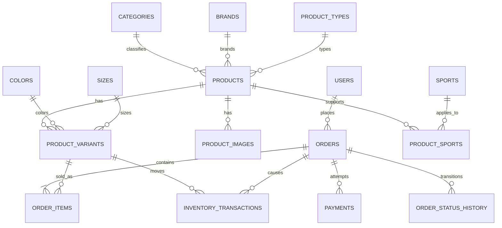

# Thiết kế cơ sở dữ liệu V2 — cửa hàng trang phục thể thao tích hợp AI

**Trạng thái:** bản thiết kế V2 đã đối chiếu riêng với toàn bộ nhiệm vụ AI mục 3.1; nhóm cần review các quyết định được đánh dấu trước khi viết migration.
**Phạm vi:** một cửa hàng, một kho logic, một tiền tệ VND, PostgreSQL + pgvector.
**Nguồn đối chiếu:** `plan.md`, mã nguồn và migration hiện tại trong `backend/`, `chatbot-service/`, `visual-search-service/`. Đây là schema V2 mới, **không** phải bản sao của 52 migration legacy.
**Phiếu chốt quyết định và triển khai:** [database-implementation-plan.md](database-implementation-plan.md). Điền các quyết định còn mở ở đó trước khi viết migration cho từng đợt.

## 1. Mục tiêu và quyết định nền tảng

1. Commerce Core (Spring Boot) là nguồn chuẩn duy nhất cho catalog, giá, tồn kho, người dùng, đơn hàng và thanh toán.
2. AI Retrieval (Python) sở hữu chỉ mục tìm kiếm, embedding, tri thức RAG, mô hình khuyến nghị và dữ liệu đánh giá. Dữ liệu sản phẩm ở đây là bản đọc có thể tái tạo.
3. Assistant (Python) sở hữu hội thoại. Nó đọc sản phẩm/đơn hàng qua API của Commerce và gọi Retrieval API; không đọc trực tiếp bảng nghiệp vụ.
4. Giao dịch Commerce dùng REST; đồng bộ bản đọc AI bằng transactional outbox → RabbitMQ → consumer idempotent. Không dùng RabbitMQ hoặc Redis làm nơi lưu dữ liệu nghiệp vụ bền vững.
5. Một PostgreSQL vật lý cho môi trường demo, tách schema và quyền ghi. Frontend chỉ gọi API.
6. Tiền dùng `numeric(14,2)`, thời gian dùng `timestamptz` UTC, khóa chính dùng `uuid`, mã nghiệp vụ dùng mã ổn định viết hoa, cột `created_at`/`updated_at` dùng nhất quán. Mọi bảng giao dịch có `created_at`; bảng có thể sửa có thêm `updated_at`.
7. Xóa mềm catalog (`status`), không cascade xóa đơn hàng/thanh toán/nhật ký kho. Ảnh lưu Cloudinary; PostgreSQL lưu URL, `public_id`, checksum và nguồn/quyền sử dụng.
8. Dữ liệu thí nghiệm phải truy ngược được tới phiên bản catalog, tập truy vấn/ảnh, nhãn, model, prompt, cấu hình và Git commit. Tập DEV dùng để chọn cấu hình; tập TEST chỉ dùng để báo cáo kết quả cuối.

**Môi trường baseline:** một Supabase Free project tên logic `supabase-v2-demo` là PostgreSQL tích hợp/demo duy nhất và chứa các schema `public`, `ai_retrieval`, `evaluation`, `assistant`. PostgreSQL local chỉ được khởi động khi phát triển migration, chạy lại từ database sạch, kiểm thử ràng buộc/đồng thời hoặc thao tác có khả năng phá dữ liệu; local không phải dịch vụ phải chạy thường trực. Supabase chỉ lưu database/vector và không chạy Qwen/BGE-M3/SigLIP2: Spring Boot, Python AI Service và Ollama chạy trên máy phát triển hoặc compute host riêng; ảnh vẫn ở Cloudinary. Mọi migration phải qua local sạch trước rồi mới do một người được giao chạy lên Supabase theo O03; không thử migration phá hủy trực tiếp trên project demo.

**Dữ liệu khởi đầu V2:** database cũ đã trắng và không có catalog/user/order/payment/inventory cần chuyển. Không chạy 52 migration legacy và không viết data migration cho dữ liệu không tồn tại. Baseline V2 tạo schema mới, seed taxonomy/config bằng migration idempotent, sau đó nhập 30–50 sản phẩm pilot mới qua manifest có nguồn/checksum; dữ liệu demo/synthetic phải tuân O02.

| Schema | Owner ghi | Nội dung |
|---|---|---|
| `public` | `commerce_app` | Identity, catalog, bán hàng, kho, quản trị, interaction, outbox |
| `ai_retrieval` | `ai_retrieval_app` | Search read model, vector, knowledge, recommendation, indexing |
| `evaluation` | `ai_retrieval_app` | Dataset, ground truth, run, kết quả, metric |
| `assistant` | `assistant_app` | Session, message, feedback, tool audit |

**Quyết định O03 — ownership và migration:** owner trong bảng trên là write owner ở mức service, không giới hạn thành viên nào được sửa code. Mọi thành viên được đề xuất và chỉnh sửa thiết kế/migration; sau khi nhóm review và Chủ dự án phê duyệt, thành viên được giao có thể thực hiện trên máy của mình. Mỗi lần triển khai chỉ một người được giao chạy migration đã duyệt lên Supabase integration/demo, không chạy đồng thời. Migration phải chạy đạt trên PostgreSQL local sạch, được lưu trong repository và có bằng chứng Flyway history/đối chiếu schema sau triển khai; không sửa schema thủ công bằng Supabase Table Editor. Storefront/Admin chỉ gọi API; service không ghi schema của service khác. Runtime dùng role riêng với quyền tối thiểu, không dùng owner/superuser.

**Tổ chức thực hiện và mốc demo:** cả nhóm cùng chịu trách nhiệm cho Commerce, AI Retrieval và Assistant; thành viên không bị cố định vào một nhóm chức năng. Tuy nhiên, mỗi task phải có một người thực hiện và một người review được ghi nhận; mỗi lần chạy migration lên Supabase chỉ có một người được giao theo O03. Mốc demo đầu tiên là **30/10/2026**, gồm catalog, đặt hàng, thanh toán, tồn kho và AI pilot; chỉ các bảng trực tiếp phục vụ phạm vi này được đưa vào baseline đầu tiên.

**Quy ước bảng dưới đây:** `PK` là khóa chính, `FK →` là khóa ngoại, `UQ` là duy nhất, `NN` là NOT NULL. Các cột không ghi `NN` được phép NULL. `status`/`type` là `varchar` có `CHECK` hoặc lookup code; không dùng PostgreSQL ENUM để dễ phát triển migration. Tất cả FK cần index nếu chưa là tiền tố của PK/UQ.

## 2. `public` — danh tính và phân quyền

| Bảng | Cột thiết kế | Khóa và quy tắc |
|---|---|---|
| `users` | `id uuid PK DEFAULT gen_random_uuid()`, `email varchar(255) NN`, `password_hash varchar(255)`, `full_name varchar(150) NN`, `phone varchar(20)`, `role_code varchar(30) NN DEFAULT 'CUSTOMER'`, `status varchar(20) NN DEFAULT 'ACTIVE'`, `last_login_at timestamptz`, `anonymized_at timestamptz`, `created_at timestamptz NN`, `updated_at timestamptz NN` | Functional UQ index `lower(email)`; CHECK email đã trim/lowercase, tên không rỗng, phone hợp lệ nếu có. Role: `CUSTOMER`, `SALES_STAFF`, `WAREHOUSE_STAFF`, `ADMIN`; status: `ACTIVE`, `LOCKED`, `DEACTIVATED`. `password_hash` chỉ có ở tài khoản LOCAL; không lưu mật khẩu thô. Index `(role_code, status)` phục vụ danh sách admin; không tạo index riêng trên `status` nếu query không dùng. |
| `user_identities` | `id uuid PK DEFAULT gen_random_uuid()`, `user_id uuid NN`, `provider varchar(30) NN`, `provider_subject varchar(255) NN`, `provider_email varchar(255)`, `last_login_at timestamptz`, `created_at timestamptz NN`, `updated_at timestamptz NN` | FK → `users` `ON DELETE CASCADE`; baseline provider chỉ `GOOGLE`; UQ `(provider, provider_subject)` và UQ `(user_id, provider)`. `provider_subject` lưu Google `sub` ổn định, không dùng email thay subject; không lưu access/refresh token của Google. Baseline không tự liên kết tài khoản LOCAL và GOOGLE trùng email. |
| `addresses` | `id uuid PK DEFAULT gen_random_uuid()`, `user_id uuid NN`, `receiver_name varchar(150) NN`, `phone varchar(20) NN`, `province_code varchar(30)`, `province_name varchar(100) NN`, `district_code varchar(30)`, `district_name varchar(100)`, `ward_code varchar(30)`, `ward_name varchar(100) NN`, `address_line varchar(255) NN`, `is_default boolean NN DEFAULT false`, `created_at timestamptz NN`, `updated_at timestamptz NN` | FK → `users` `ON DELETE CASCADE`; CHECK chuỗi bắt buộc đã trim/không rỗng và phone hợp lệ; district được phép NULL. Partial UQ `(user_id) WHERE is_default`; index `(user_id, created_at DESC)`. Code địa giới được phép NULL trong pilot dùng nhập tay, nhưng nếu có code thì phải lưu kèm tên; order luôn giữ snapshot độc lập. |
| `refresh_tokens` | `id uuid PK DEFAULT gen_random_uuid()`, `user_id uuid NN`, `token_hash char(64) NN`, `expires_at timestamptz NN`, `revoked_at timestamptz`, `revocation_reason varchar(30)`, `created_at timestamptz NN` | FK → `users` `ON DELETE CASCADE`; UQ `token_hash`; CHECK SHA-256 hex và các mốc thời gian hợp lệ; index `(user_id, expires_at)` và cleanup index theo `expires_at`. Chỉ lưu SHA-256, không lưu JWT thô. Refresh token xoay một lần; logout/reset mật khẩu/khóa hoặc vô hiệu hóa tài khoản phải revoke token phù hợp. |
| `password_reset_tokens` | `id uuid PK DEFAULT gen_random_uuid()`, `user_id uuid NN`, `token_hash char(64) NN`, `expires_at timestamptz NN`, `used_at timestamptz`, `created_at timestamptz NN` | FK → `users` `ON DELETE CASCADE`; UQ `token_hash`; CHECK SHA-256 hex và thời gian; index `(user_id, created_at DESC)` và cleanup index theo `expires_at`. Token dùng đúng một lần bằng atomic update `used_at IS NULL AND expires_at > now`; chỉ phát hành cho tài khoản LOCAL đang `ACTIVE`. |

**Review 1A.1 Identity — 09/10/2026:** Spring Boot tiếp tục tự quản lý JWT, refresh token, mật khẩu BCrypt và Google ID-token; Supabase chỉ cung cấp PostgreSQL, **không dùng Supabase Auth** trong baseline. Một constraint trigger deferred (hoặc cơ chế DB tương đương có test) phải bảo đảm chế độ credential hợp lệ khi commit: tài khoản LOCAL có `password_hash` và không có external identity; tài khoản GOOGLE có `password_hash IS NULL` và đúng một `user_identities` provider `GOOGLE`. Tạo user Google và identity phải ở cùng transaction. Forgot/reset password cho Google là no-op với response chung, không phát token vô dụng. Khi khóa/vô hiệu hóa/đổi mật khẩu phải revoke refresh token; tác vụ hằng ngày xóa refresh token sau 30 ngày kể từ khi hết hạn/revoke và reset token sau 7 ngày kể từ khi hết hạn/đã dùng.

Không hard-delete user đã có order/payment: yêu cầu xóa tài khoản chuyển `DEACTIVATED`, xóa identity/token/address, xóa hoặc thay PII bằng giá trị ẩn danh duy nhất và ghi `anonymized_at`; snapshot trên order vẫn được giữ. Checkout V2 yêu cầu user đăng nhập như code hiện tại; guest cart được phép, guest order chưa nằm trong baseline. `orders` giữ snapshot người nhận để chỉnh/sửa/xóa địa chỉ sau này không thay đổi lịch sử.

## 3. `public` — taxonomy và catalog

### 3.1. Bảng tham chiếu

| Bảng | Cột thiết kế | Khóa và quy tắc |
|---|---|---|
| `categories` | `id uuid PK`, `parent_id uuid`, `code varchar(50) NN`, `name varchar(150) NN`, `slug varchar(180) NN`, `status`, `sort_order integer NN`, timestamps | FK `parent_id` → chính bảng này; UQ `code`, `slug`; chặn chu trình cây trong service/trigger. |
| `brands` | `id uuid PK`, `code`, `name`, `slug`, `status`, timestamps | UQ `code`, `slug`. |
| `size_systems` | `id uuid PK`, `code`, `name`, `status` | Ví dụ `APPAREL_INT`, `SHOES_EU`, `ONE_SIZE`; UQ `code`. |
| `sizes` | `id uuid PK`, `size_system_id uuid NN`, `code varchar(30) NN`, `display_name`, `sort_order integer NN` | FK → `size_systems`; UQ `(size_system_id, code)`. |
| `product_types` | `id uuid PK`, `code`, `name`, `default_size_system_id uuid`, `status` | FK → `size_systems`; UQ `code`; seed v1: `SPORTS_TOP`, `SPORTS_BOTTOM`, `SPORTS_SHOES`, `SPORTS_UNIFORM`, `ACCESSORY`. |
| `sports` | `id uuid PK`, `code`, `name`, `status` | UQ `code`; seed v1: `FOOTBALL`, `RUNNING`. |
| `use_cases` | `id uuid PK`, `code`, `name`, `status` | UQ `code`; tập luyện, thi đấu, mặc hằng ngày… |
| `materials` | `id uuid PK`, `code`, `name`, `status` | UQ `code`; polyester, cotton, elastane… |
| `technologies` | `id uuid PK`, `code`, `name`, `status` | UQ `code`; thấm hút, thoáng khí, chống nước… |
| `colors` | `id uuid PK`, `code`, `name`, `family_code varchar(30) NN`, `hex_value char(7)`, `status` | UQ `code`; `family_code` cho tìm kiếm màu gần đúng. |
| `catalog_datasets` | `id uuid PK`, `name varchar(100) NN`, `version varchar(50) NN`, `manifest_uri text NN`, `manifest_checksum char(64) NN`, `source_description text`, `license_code varchar(50) NN`, `status varchar(20) NN`, `imported_at timestamptz`, `created_at NN` | UQ `(name, version)`; manifest liệt kê nguồn từng bản ghi, cách chuẩn hóa và ảnh. `DRAFT` → `VALIDATED` → `FROZEN`; bản FROZEN không sửa tại chỗ. |

Các bảng taxonomy có `code` ổn định và tên tiếng Việt có thể đổi. Seed dữ liệu chuẩn trước catalog; không đưa chuỗi tự do từ LLM vào FK hoặc mã lọc.

**Review 1A.2 Taxonomy:** mọi bảng lookup dùng `id uuid DEFAULT gen_random_uuid()`, `code varchar(50) NN`, `name varchar(150) NN`, `status varchar(20) NN DEFAULT 'ACTIVE'`, `created_at/updated_at timestamptz NN`, CHECK code uppercase theo mẫu `^[A-Z][A-Z0-9_]*$`, tên không rỗng và UQ `code`; chỉ `categories`/`brands` cần `slug` lowercase UQ. FK từ catalog dùng `ON DELETE RESTRICT`; taxonomy đã được tham chiếu chỉ chuyển `INACTIVE`, không xóa. `categories.parent_id` có CHECK `parent_id <> id` và trigger/service có test chặn chu trình sâu; index `(parent_id, sort_order)`. `product_types.default_size_system_id` là NN trong baseline. `sizes.sort_order >= 0`; `colors.hex_value` nếu có phải khớp `^#[0-9A-Fa-f]{6}$`. Seed dùng UPSERT theo `code`, không thay UUID/code đã phát hành; giữ `NO_BRAND` cho sản phẩm không thương hiệu và seed hai thương hiệu kinh doanh ban đầu `NIKE`, `ADIDAS` ở trạng thái `ACTIVE`.

### 3.2. Sản phẩm, SKU và ảnh

| Bảng | Cột thiết kế | Khóa và quy tắc |
|---|---|---|
| `products` | `id uuid PK`, `category_id uuid NN`, `brand_id uuid NN`, `product_type_id uuid NN`, `size_system_id uuid NN`, `name varchar(255) NN`, `slug varchar(300) NN`, `short_description`, `description text`, `gender_code varchar(12) NN`, `attributes jsonb NN DEFAULT '{}'`, `status varchar(20) NN`, `catalog_version bigint NN DEFAULT 1`, `data_source varchar(20) NN`, timestamps | FK → category/brand/type/size system; UQ `slug`; gender chỉ gồm `MEN`, `WOMEN`, `UNISEX`; status `DRAFT`, `ACTIVE`, `INACTIVE`; `data_source` bắt buộc, không default, bất biến và chỉ `REAL`, `DEMO`, `SYNTHETIC`. `catalog_version` tăng khi mọi dữ liệu ảnh hưởng chỉ mục thay đổi. Storefront production chỉ publish product `REAL`. |
| `catalog_dataset_items` | `dataset_id uuid NN`, `product_id uuid NN`, `source_record_id varchar(150) NN`, `source_uri text`, `normalized_checksum char(64) NN`, `imported_at timestamptz NN` | PK `(dataset_id, product_id)`; FK → `catalog_datasets`, `products`; UQ `(dataset_id, source_record_id)`. Một product có thể xuất hiện trong nhiều phiên bản dataset. |
| `product_sports` | `product_id uuid NN`, `sport_id uuid NN` | PK kép; FK → `products`, `sports`. |
| `product_use_cases` | `product_id uuid NN`, `use_case_id uuid NN` | PK kép; FK → `products`, `use_cases`. |
| `product_materials` | `product_id uuid NN`, `material_id uuid NN`, `percentage numeric(5,2)` | PK kép; FK → `products`, `materials`; tỷ lệ nếu có trong `(0,100]`. |
| `product_technologies` | `product_id uuid NN`, `technology_id uuid NN` | PK kép; FK → `products`, `technologies`. |
| `product_variants` | `id uuid PK`, `product_id uuid NN`, `sku varchar(100) NN`, `size_id uuid NN`, `color_id uuid NN`, `price numeric(14,2) NN`, `compare_at_price numeric(14,2)`, `stock_quantity integer NN DEFAULT 0`, `reserved_quantity integer NN DEFAULT 0`, `reorder_point integer NN DEFAULT 0`, `status varchar(20) NN`, `version integer NN`, timestamps | FK → product/size/color; UQ `sku`, UQ `(product_id, size_id, color_id)`, UQ `(product_id, id)` làm khóa đích cho composite FK; `price > 0`, `stock >= 0`, `0 <= reserved <= stock`, `reorder_point >= 0`; status `ACTIVE`, `OUT_OF_STOCK`, `INACTIVE`. `version` phục vụ optimistic locking; thao tác kho dùng row lock. |
| `product_images` | `id uuid PK`, `product_id uuid NN`, `variant_id uuid`, `color_id uuid`, `storage_provider varchar(20) NN DEFAULT 'CLOUDINARY'`, `public_id varchar(255) NN`, `asset_version varchar(50) NN`, `secure_url text NN`, `format varchar(20) NN`, `bytes bigint`, `alt_text`, `sort_order integer NN`, `is_primary boolean NN`, `checksum char(64)`, `width integer`, `height integer`, `source_kind varchar(20) NN`, `source_uri text`, `license_code varchar(50) NN`, `source_group_code varchar(100)`, timestamps | FK `product_id` → `products`; composite FK `(product_id, variant_id)` → `product_variants(product_id, id)` khi `variant_id` khác NULL; FK → color; UQ `(storage_provider, public_id)`; một ảnh primary mỗi product bằng partial UQ `(product_id) WHERE is_primary`; `sort_order >= 0`, `bytes,width,height > 0` nếu có. Trigger/service có test bắt buộc `color_id` trùng màu của variant khi `variant_id` khác NULL. `source_kind`: `OWNED`, `LICENSED`, `SYNTHETIC`. Ảnh dùng để publish/index phải có checksum SHA-256, kích thước, format, asset version và quyền sử dụng hợp lệ. |

`price` chỉ có **một nguồn chuẩn ở `product_variants`**. Giá thấp nhất/cao nhất của product là dữ liệu tính toán hoặc read model. Thuộc tính cần lọc thường xuyên nằm trong cột/FK; `attributes` chỉ dành cho thuộc tính thưa như fit, mức compression hoặc điều kiện thời tiết. Quy tắc chuyển sang `ACTIVE`: product có ít nhất một variant hợp lệ và một ảnh hợp lệ; kiểm tra khi publish trong cùng transaction. Size của variant phải thuộc `size_system_id` của product, kiểm tra ở service hoặc trigger.

**Cloudinary và pipeline ảnh AI:** Cloudinary giữ file ảnh; `public.product_images` mới là nguồn chuẩn về ảnh nào thuộc product/variant/color nào. Upload phải dùng `public_id` duy nhất, không overwrite asset tại chỗ; nếu thay ảnh thì tạo asset version/checksum mới và phát outbox event sau khi transaction Commerce commit. Event tối thiểu gồm `image_id`, `product_id`, `variant_id`/`color_id`, `public_id`, `asset_version`, versioned `secure_url`, checksum, format, bytes, width/height và aggregate version. AI Retrieval chỉ tải URL HTTPS từ allowlist Cloudinary, áp dụng timeout/giới hạn dung lượng/content-type, tính lại SHA-256 rồi mới chạy đúng preprocessing version của model. Thumbnail/transformation dùng để hiển thị không được dùng làm nguồn embedding. Xóa ảnh làm read model/embedding chuyển không hoạt động hoặc bị xóa idempotent; xóa asset Cloudinary vẫn thực hiện sau DB commit. Ảnh query online được xử lý tạm thời theo chính sách O01, không tự động nhập vào catalog/dataset; ảnh benchmark nằm ở folder/dataset riêng và có manifest/checksum/license.

**Quyết định B01 — catalog v1:** giới tính dùng `MEN`, `WOMEN`, `UNISEX` và không dùng làm cây danh mục. Một product có thể gắn nhiều môn thể thao; baseline seed `FOOTBALL` và `RUNNING`. Áo, quần và đồng phục dùng `APPAREL_INT` với `XS`, `S`, `M`, `L`, `XL`, `XXL`; giày dùng `SHOES_EU` với size `36`–`45`; phụ kiện không phân size dùng `ONE_SIZE`. `SPORTS_UNIFORM` là một bộ gồm áo và quần, được bán và quản lý tồn kho như một SKU theo tổ hợp size–màu; hai thành phần trong bộ dùng cùng size. Baseline không quản lý tồn kho áo và quần của bộ riêng biệt. Product bắt buộc có category, product type, gender và size system; variant bắt buộc có SKU, size, màu, giá, tồn kho và trạng thái. Các code taxonomy được seed ổn định bằng migration.

Mỗi đợt import catalog phải tạo `catalog_datasets` và `catalog_dataset_items` trước khi được dùng trong benchmark. `manifest_checksum` và `normalized_checksum` cho phép đối chiếu lại đúng dữ liệu đã đánh giá. Không dùng `data_source` (`REAL`/`DEMO`/`SYNTHETIC`) thay cho version của dataset: hai khái niệm có mục đích khác nhau.

**Review 1A.3–1A.4 Catalog:** slug/SKU/code được chuẩn hóa trước khi ghi và bảo vệ bằng UQ không phân biệt hoa thường khi phù hợp. Mọi FK taxonomy/product dùng `RESTRICT/NO ACTION`; xóa catalog bằng status, không cascade vào order/history. Trigger/service có test phải bảo đảm size của variant thuộc `products.size_system_id`, color ảnh khớp variant và product chỉ chuyển `ACTIVE` khi có ít nhất một variant cùng ảnh hợp lệ. `catalog_datasets` đã `FROZEN` cùng item của nó là bất biến; thay đổi tạo version mới. `products.data_source` là bất biến; các cột giá/tồn chỉ do luồng sở hữu cập nhật. Không tạo index cho từng cột ít chọn lọc; index catalog được chốt theo query storefront và kiểm tra lại bằng `EXPLAIN` sau khi có dữ liệu pilot.

## 4. `public` — giỏ hàng, đơn hàng, thanh toán, phát sinh

| Bảng | Cột thiết kế | Khóa và quy tắc |
|---|---|---|
| `carts` | `id uuid PK`, `user_id uuid`, `session_id varchar(255)`, timestamps | FK → `users` `ON DELETE CASCADE`; `CHECK(num_nonnulls(user_id, session_id) = 1)` để giỏ chỉ thuộc user hoặc guest session; partial UQ `(user_id) WHERE user_id IS NOT NULL` và `(session_id) WHERE session_id IS NOT NULL`. Baseline lưu một giỏ hiện hành mỗi user/session; merge guest cart phải chuyển item trong transaction, không để cart có cả hai identity. |
| `cart_items` | `id uuid PK`, `cart_id uuid NN`, `variant_id uuid NN`, `quantity integer NN`, timestamps | FK → cart/variant; UQ `(cart_id, variant_id)`; `quantity > 0`. Giá trong giỏ chỉ là giá hiển thị, checkout luôn đọc lại giá chuẩn. |
| `orders` | `id uuid PK`, `order_code varchar(50) NN`, `user_id uuid NN`, `address_snapshot jsonb NN`, `subtotal_amount numeric(14,2) NN`, `shipping_fee numeric(14,2) NN DEFAULT 0`, `discount_amount numeric(14,2) NN DEFAULT 0`, `total_amount numeric(14,2) NN`, `currency_code char(3) NN DEFAULT 'VND'`, `payment_method`, `order_status`, `payment_status`, `note`, `data_source varchar(20) NN`, `placed_at`, `delivered_at`, `return_eligible_until`, timestamps | FK → `users` `ON DELETE RESTRICT`; UQ `order_code`; tiền không âm; CHECK `total_amount = subtotal_amount + shipping_fee - discount_amount`; method `COD`, `VNPAY`; `data_source` bắt buộc, không default, bất biến và chỉ `REAL`, `DEMO`, `SYNTHETIC`. `address_snapshot` được validate bằng JSON Schema version hóa ở service trước khi ghi. `delivered_at`/`return_eligible_until` được ghi một lần ở lần giao thành công đầu tiên. |
| `order_items` | `id uuid PK`, `order_id uuid NN`, `product_id uuid NN`, `variant_id uuid NN`, `product_name_snapshot`, `sku_snapshot`, `size_snapshot`, `color_snapshot`, `unit_price_snapshot`, `quantity`, `line_total`, `discount_allocated`, `net_line_amount`, `return_pending_quantity DEFAULT 0`, `returned_quantity DEFAULT 0` | FK → order; composite FK `(product_id, variant_id)` → `product_variants(product_id, id)`; UQ `(id, order_id)` làm khóa đích cho return item; `quantity > 0`; snapshot bắt buộc, `line_total = unit_price_snapshot * quantity`, `net_line_amount = line_total - discount_allocated`; CHECK các bộ đếm trả không âm và `return_pending_quantity + returned_quantity <= quantity`. Không xóa vật lý product/variant đã từng được đặt. |
| `order_status_history` | `id uuid PK`, `order_id uuid NN`, `from_status`, `to_status NN`, `reason`, `actor_user_id`, `occurred_at NN` | FK → order/user; append-only; index `(order_id, occurred_at)`. |
| `payments` | `id uuid PK`, `order_id uuid NN`, `provider varchar(20) NN`, `transaction_ref varchar(150) NN`, `amount numeric(14,2) NN`, `status`, `gateway_transaction_no`, `expires_at`, `paid_at`, timestamps | FK → order `ON DELETE RESTRICT`; UQ `(provider, transaction_ref)`, UQ `(id, order_id)` làm khóa đích cho refund; CHECK `amount > 0` và thời gian/trạng thái nhất quán; một order có thể có nhiều lần thử nhưng chỉ một payment đang `PENDING` cho cùng provider bằng partial UQ phù hợp. Provider `COD`, `VNPAY`; status gồm `UNPAID`, `PENDING`, `PAID`, `FAILED`, `CANCELLED`, `PARTIALLY_REFUNDED`, `REFUNDED`. COD tạo payment nội bộ `UNPAID` khi checkout và chuyển `PAID` khi giao để mọi refund luôn tham chiếu được payment. |
| `payment_events` | `id uuid PK`, `payment_id uuid NN`, `provider varchar(20) NN`, `provider_event_key char(64) NN`, `event_type`, `verified boolean NN`, `payload_redacted jsonb`, `received_at NN` | FK → payments; UQ `(provider, provider_event_key)` để callback idempotent trên toàn provider, không chỉ trong một payment; `provider_event_key` là SHA-256 payload đã xác thực/canonicalize; không lưu chữ ký, thông tin thẻ hay secret. |
| `shipping_methods` | `id uuid PK`, `code`, `name`, `base_fee`, `status`, timestamps | UQ `code`; nếu có nhiều hình thức giao. |
| `shipments` | `id uuid PK`, `order_id uuid NN`, `shipping_method_id uuid`, `tracking_number`, `status`, `shipped_at`, `delivered_at`, timestamps | FK → order/method; UQ tracking khi khác NULL; đơn có thể có nhiều lần giao. |
| `returns` | `id uuid PK`, `order_id uuid NN`, `requested_by uuid NN`, `reason_code`, `description`, `status`, `requested_at`, `approved_at`, `received_at`, `resolved_at`, `handled_by uuid`, timestamps | FK → order/users; UQ `(id, order_id)` làm khóa đích cho return item/refund; status `REQUESTED`, `APPROVED`, `RECEIVED`, `REFUNDED`, `REJECTED`, `CANCELLED`; partial UQ `(order_id) WHERE status IN ('REQUESTED','APPROVED','RECEIVED')` để mỗi order chỉ có một return đang mở. |
| `return_items` | `id uuid PK`, `return_id uuid NN`, `order_id uuid NN`, `order_item_id uuid NN`, `quantity integer NN`, `condition_code`, `resolution_code`, `refund_amount`, `restocked boolean NN DEFAULT false` | Composite FK `(return_id, order_id)` → `returns(id, order_id)` và `(order_item_id, order_id)` → `order_items(id, order_id)`; UQ `(return_id, order_item_id)`; `quantity > 0`; resolution V2 chỉ `REFUND`, `REJECT`; `refund_amount > 0` iff resolution là `REFUND`; `restocked=true` chỉ khi đã nhận, chấp nhận và condition là `UNOPENED`/`LIKE_NEW`. |
| `refunds` | `id uuid PK`, `order_id uuid NN`, `return_id uuid`, `payment_id uuid NN`, `amount numeric(14,2) NN`, `shipping_refund_amount numeric(14,2) NN DEFAULT 0`, `provider`, `status`, `gateway_request_id`, `refunded_at`, timestamps | `amount` là tổng tiền hoàn, trong đó `shipping_refund_amount` là phần phí giao; FK → order; composite FK `(payment_id, order_id)` → `payments(id, order_id)`; composite FK `(return_id, order_id)` → `returns(id, order_id)` khi `return_id` khác NULL; `amount > 0`, `0 <= shipping_refund_amount <= amount`; UQ gateway request ID khi có; partial UQ trên `payment_id WHERE return_id IS NULL AND status IN ('PENDING','PROCESSING','COMPLETED')` chống refund hủy đơn trùng; partial UQ trên `return_id WHERE return_id IS NOT NULL AND status IN ('PENDING','PROCESSING','COMPLETED')` chống refund return trùng. |

`orders.order_status` là trạng thái hiện tại; `order_status_history` là lịch sử. Trạng thái đơn V2: `PENDING_CONFIRMATION`, `CONFIRMED`, `PACKING`, `SHIPPING`, `DELIVERED`, `CANCELLED`; không dùng `CANCELLATION_REQUESTED` hoặc `CANCELLATION_APPROVED`. Nhân viên có thể sửa hai chiều giữa các trạng thái vận hành để phản ánh thực tế. Khách hoặc nhân viên hủy bất kỳ lúc nào trước `DELIVERED` thì chuyển thẳng `CANCELLED` và hoàn kho/nhả giữ chỗ trong cùng transaction. Nếu VNPAY đã thu tiền, hệ thống đồng thời tạo một refund `PENDING`; trạng thái đơn và trạng thái hoàn tiền độc lập. `CANCELLED` là trạng thái cuối, còn đơn đã `DELIVERED` xử lý bằng return. VNPAY chỉ được rời `PENDING_CONFIRMATION` sau khi `payment_status = 'PAID'`; callback thanh toán không tự xác nhận order. Lần đầu đến `DELIVERED` ghi `delivered_at` và COD chuyển `PAID`; sửa lại trạng thái vận hành không xóa dấu thời gian giao đầu tiên hoặc tự đảo giao dịch thanh toán.

Luồng checkout: khóa pessimistic tất cả variant theo thứ tự UUID tăng dần → đọc lại giá và `available = stock - reserved` → tạo order/items snapshot → giữ tồn, ghi movement và xóa giỏ → commit. Hai checkout tranh cùng SKU được tuần tự hóa; giao dịch sau phải đọc lượng mới và thất bại toàn bộ nếu thiếu, không oversell. Khi xác nhận lần đầu, chuyển reservation thành trừ tồn đúng một lần. Callback VNPAY phải xác thực chữ ký, khóa order trước payment rồi xử lý theo khóa sự kiện duy nhất. Hết hạn, hủy và refund đều khóa order; retry phải trả lại kết quả hiện có và không lặp movement/refund. Đơn/giỏ/AI không bao giờ tự cập nhật `stock_quantity` ngoài InventoryService.

**Quyết định B05 — callback VNPay:** chỉ IPN/callback tới backend được quyền đổi trạng thái payment; return URL trên trình duyệt chỉ dùng hiển thị và phải đọc lại kết quả từ backend. Xác thực HMAC-SHA512 constant-time trên payload canonicalize sau khi bỏ `vnp_SecureHash` và `vnp_SecureHashType`, sau đó kiểm tra merchant `vnp_TmnCode`, trường bắt buộc, payment provider, `vnp_TxnRef`, số tiền VND chính xác và payment thuộc đúng order. Vì VNPay không cung cấp event ID IPN riêng, `provider_event_key` là SHA-256 của tập trường đã xác thực: `vnp_TmnCode`, `vnp_TxnRef`, `vnp_TransactionNo` hoặc `-`, `vnp_ResponseCode`, `vnp_TransactionStatus`, `vnp_Amount`, `vnp_PayDate` hoặc `-`; UQ `(provider, provider_event_key)`. Trong transaction luôn khóa `order → payment`, chèn event `ON CONFLICT DO NOTHING`, rồi chỉ xử lý nếu event mới và payment còn `PENDING`. Chỉ cặp mã `00/00` mới thành `PAID`; callback lặp hoặc callback mâu thuẫn sau trạng thái terminal không được chạy side effect hay ghi đè kết quả. Thành công đến sau khi order đã hủy vẫn ghi nhận payment `PAID`, giữ order `CANCELLED` và tạo tối đa một refund `PENDING`. Callback không hợp lệ/không khớp không sửa dữ liệu nghiệp vụ; security log chỉ lưu metadata/payload đã redacted, tuyệt đối không lưu hash secret, chữ ký hay dữ liệu nhạy cảm.

**Quyết định B07 — trả hàng và hoàn tiền:** yêu cầu phải được tạo khi order đang `DELIVERED` và không muộn hơn `return_eligible_until = delivered_at + 7 ngày`; mốc này được chốt ở lần giao thành công đầu tiên. Reason codes: `WRONG_SIZE`, `DAMAGED`, `DEFECTIVE`, `WRONG_ITEM`, `NO_LONGER_NEEDED`, `OTHER`. Với `WRONG_SIZE`/`NO_LONGER_NEEDED`, hàng phải chưa sử dụng, chưa giặt, còn nhãn/bao bì và đủ phụ kiện; hàng lỗi, hư hỏng hoặc giao sai có thể được hoàn tiền sau kiểm tra nhưng chỉ hàng `UNOPENED`/`LIKE_NEW` mới quay lại tồn bán. Đồng phục là một SKU nguyên bộ, vì vậy áo và quần phải được trả cùng nhau mới đủ điều kiện restock. V2 chỉ dùng resolution `REFUND` hoặc `REJECT`; đổi size thực hiện bằng refund rồi đặt đơn mới, chưa hỗ trợ store credit.

Khi tạo return, transaction khóa `order → order_items` theo UUID, kiểm tra cửa sổ trả và chuyển số lượng từ khả dụng sang `return_pending_quantity`; CHECK trên order item chặn tổng pending + returned vượt lượng mua ngay cả khi có hai request đồng thời. Hủy/từ chối nhả pending; nhận hàng và chấp nhận chuyển pending sang returned. `RETURN_RESTOCK:{return_id}:{return_item_id}` bảo đảm mỗi dòng chỉ hoàn kho một lần. Khi tạo refund, khóa `order → payment → return`, tính từ `net_line_amount` và các refund `PENDING`/`PROCESSING`/`COMPLETED`; tổng cam kết không được vượt tiền đã thu. Phí giao ban đầu mặc định không hoàn, chỉ được thêm cho lỗi thuộc cửa hàng với lý do được audit và tổng refund vẫn không vượt payment. Refund hoàn tất một phần đặt payment `PARTIALLY_REFUNDED`, hoàn đủ mới `REFUNDED`; return chỉ thành `REFUNDED` sau khi giao dịch tiền hoàn tất. COD được xác nhận hoàn thủ công, VNPay đi qua gateway; trạng thái refund và tác động kho độc lập, đều idempotent.

**Phạm vi migration 1B:** tạo cart, order, payment, return/refund, inventory, settings/audit/outbox và interaction theo phân bổ trong `database-implementation-plan.md`. `refunds` bắt buộc ở baseline để xử lý hủy đơn VNPAY đã thu tiền; `returns` và `return_items` được tạo cùng đợt để bảo đảm các composite FK của B06 và sẵn sàng cho B07. Chưa tạo `shipping_methods` và `shipments` trong 1B vì cửa hàng chưa tích hợp đơn vị vận chuyển: nhân viên cập nhật trạng thái vận hành trực tiếp trên `orders`, còn `shipping_fee` là snapshot của đơn. Hai bảng giao vận vẫn thuộc ERD mục tiêu và chỉ chuyển vào đợt sau khi có nghiệp vụ theo dõi phương thức, mã vận đơn hoặc nhiều lần giao thực tế.

**Review 1B Commerce:** mọi thao tác checkout/cancel/payment/refund/inventory phải đi qua service transaction và thứ tự khóa đã chốt; không cấp quyền ghi bảng Commerce cho frontend hoặc service AI. Cart dùng XOR identity; order/item/address/price là snapshot; các tổng tiền, số lượng và trạng thái có CHECK ở DB. History, payment event, inventory movement, audit và outbox là append-only; sửa sai bằng event/movement bù. Các quy tắc tổng hợp không thể biểu diễn bằng CHECK (tổng refund, tổng return, chuyển trạng thái, before/after inventory) dùng row lock + trigger/service có integration test. FK tới giao dịch dùng `RESTRICT`; chỉ dữ liệu phụ thuộc thuần như cart/token/address mới cascade. Mọi idempotency key/event key có UQ và retry phải trả kết quả hiện có.

## 5. `public` — kho, vận hành và dữ liệu hành vi

| Bảng | Cột thiết kế | Khóa và quy tắc |
|---|---|---|
| `inventory_transactions` | `id uuid PK`, `variant_id uuid NN`, `order_id uuid`, `return_id uuid`, `type varchar(30) NN`, `quantity integer NN`, `before_stock_quantity integer NN`, `after_stock_quantity integer NN`, `before_reserved_quantity integer NN`, `after_reserved_quantity integer NN`, `actor_user_id uuid`, `reason text`, `idempotency_key varchar(200) NN`, `created_at timestamptz NN` | FK → variant/order/return/user; append-only; `quantity > 0`; UQ `idempotency_key`; CHECK mọi before/after không âm và reserved không vượt stock. Types: `IMPORT`, `EXPORT`, `ADJUSTMENT_UP`, `ADJUSTMENT_DOWN`, `ORDER_RESERVE`, `ORDER_RELEASE`, `ORDER_CONFIRM_DEDUCT`, `ORDER_CANCEL_RESTOCK`, `RETURN_RESTOCK`. Trigger/service có test kiểm đúng delta theo type; thao tác thủ công bắt buộc actor + reason, thao tác order/return bắt buộc đúng source FK. |
| `site_settings` | `key varchar(100) PK`, `value jsonb NN`, `value_type`, `updated_by uuid`, `updated_at NN` | Không lưu secret; validate kiểu dữ liệu ở service. |
| `audit_logs` | `id uuid PK`, `actor_user_id uuid`, `action`, `entity_type`, `entity_id`, `details_redacted jsonb`, `occurred_at NN` | Append-only; tránh PII/token/raw payment payload. |
| `integration_outbox` | `id uuid PK`, `idempotency_key varchar(200) NN`, `event_type`, `event_version integer NN`, `aggregate_type`, `aggregate_id uuid NN`, `aggregate_version bigint NN`, `payload jsonb NN`, `status`, `attempts integer NN DEFAULT 0`, `available_at timestamptz NN`, `created_at timestamptz NN`, `published_at timestamptz`, `last_error` | Ghi cùng transaction nghiệp vụ; UQ `idempotency_key`, thường sinh từ event type + aggregate + aggregate version; CHECK status/attempts/time; index partial `(available_at, created_at) WHERE status IN ('PENDING','FAILED')`. Publisher claim theo row lock/`SKIP LOCKED`; publish lặp vẫn an toàn nhờ `processed_events`. |
| `user_interactions` | `event_id uuid PK`, `occurred_at NN`, `user_id uuid`, `anonymous_id varchar(100)`, `event_type`, `product_id uuid`, `variant_id uuid`, `request_id uuid`, `source`, `data_source varchar(20) NN`, `metadata jsonb`, `anonymized_at timestamptz` | Append-only; ít nhất user hoặc anonymous ID khi tạo; event: view, search impression/click, recommendation impression/click, add-to-cart, wishlist, purchase. `data_source` bắt buộc, không default, bất biến và chỉ `REAL`, `DEMO`, `SYNTHETIC`; không ghi PII trong metadata. Bản ghi có định danh/giả danh giữ 180 ngày rồi xóa; yêu cầu xóa tài khoản phải gỡ liên kết hoặc ẩn danh trong tối đa 7 ngày. |

**Cảnh báo tồn thấp:** baseline chưa cần bảng riêng. Truy vấn variant `status='ACTIVE' AND stock_quantity-reserved_quantity <= reorder_point`; nếu muốn ghi nhận đã xem/đã xử lý cảnh báo, thêm `stock_alerts` ở migration sau. **Nhiều kho:** chưa cần; khi có yêu cầu thật, thêm `warehouses` và `inventory_balances(warehouse_id, variant_id)` thay vì giả lập nhiều kho bằng `product_variants`.

**Quyết định B04 — sổ kho:** `stock_quantity` là tồn thực tế, `reserved_quantity` là lượng đang giữ cho đơn và lượng bán được là `stock_quantity - reserved_quantity`. Mọi thay đổi phải đi qua `InventoryService`: khóa pessimistic các variant theo UUID tăng dần, kiểm tra điều kiện, cập nhật balance và chèn movement trong cùng transaction. Khóa idempotency được sinh ổn định từ loại thao tác + nguồn nghiệp vụ + variant, ví dụ `ORDER_RESERVE:{order_id}:{variant_id}`; thao tác thủ công nhận request UUID từ client. Khi retry hoặc hai request cùng lúc dùng cùng khóa, trả kết quả đã có và không tác động kho lần hai. `EXPORT` và `ADJUSTMENT_DOWN` không được dùng phần đã reserve. Không UPDATE/DELETE movement cũ; sai lệch được sửa bằng movement bù có actor và reason. Baseline là một kho logic, chưa tạo phiếu nhập/nhà cung cấp; nhập, xuất và điều chỉnh thủ công bắt buộc có người thực hiện và lý do.

## 6. `ai_retrieval` — tìm kiếm, RAG và khuyến nghị

| Bảng | Cột thiết kế | Khóa và quy tắc |
|---|---|---|
| `product_search_documents` | `product_id uuid PK`, `name`, `document_text NN`, `document_hash char(64) NN`, `search_vector tsvector`, `category_code`, `brand_code`, `product_type_code`, `gender_code`, `sport_codes text[]`, `use_case_codes text[]`, `material_codes text[]`, `source_version bigint NN`, `indexed_at`, `status` | Bản đọc theo product; `source_version` ngăn event cũ ghi đè event mới. `search_vector` GIN. Không xem giá/tồn ở đây là nguồn chuẩn. |
| `search_variant_facets` | `variant_id uuid PK`, `product_id uuid NN`, `size_code`, `color_code`, `color_family_code`, `price`, `available_quantity`, `status`, `source_version`, `indexed_at` | Bản đọc theo **variant** để điều kiện màu + size + giá phải khớp trên cùng một SKU; FK nội bộ product_id → `product_search_documents`. Kết quả vẫn được Commerce xác minh lại. |
| `embedding_models` | `id uuid PK`, `modality`, `provider`, `model_name`, `model_version`, `dimensions integer NN`, `distance_metric`, `preprocessing_version varchar(50) NN`, `status`, `activated_at`, `created_at` | Modality `PRODUCT_TEXT`, `PRODUCT_IMAGE`, `KNOWLEDGE`; UQ `(modality, provider, model_name, model_version, preprocessing_version)`; partial UQ `(modality) WHERE status='ACTIVE'`. Cùng model nhưng thay tiền xử lý ảnh/văn bản phải là phiên bản index khác. |
| `product_text_embeddings` | `product_id uuid NN`, `model_id uuid NN`, `document_hash char(64)`, `embedding vector(1024)`, `status`, `attempts`, `last_error`, `embedded_at` | PK `(product_id, model_id)`; FK nội bộ document/model; baseline `BAAI/bge-m3`; chỉ `READY` khi vector và hash có giá trị. |
| `product_image_embeddings` | `image_id uuid NN`, `product_id uuid NN`, `model_id uuid NN`, `source_public_id varchar(255) NN`, `source_asset_version varchar(50) NN`, `image_hash char(64)`, `embedding vector(768)`, `status`, `attempts`, `last_error`, `embedded_at` | PK `(image_id, model_id)`; baseline `google/siglip2-base-patch16-224`; không FK xuyên schema tới `public.product_images`; nhận tạo/thay/xóa ảnh qua event và chỉ `READY` sau khi checksum nguồn khớp. |
| `knowledge_documents` | `id uuid PK`, `code`, `title`, `source_uri`, `version`, `checksum`, `status`, `effective_from`, timestamps | UQ `(code, version)`; lưu nguồn và bản chính sách có hiệu lực. |
| `knowledge_chunks` | `id uuid PK`, `document_id uuid NN`, `chunk_index integer NN`, `section`, `content NN`, `content_hash char(64) NN`, `metadata jsonb` | FK → document; UQ `(document_id, chunk_index)`. |
| `knowledge_embeddings` | `chunk_id uuid NN`, `model_id uuid NN`, `content_hash`, `embedding vector(1024)`, `status`, `embedded_at` | PK `(chunk_id, model_id)`; FK nội bộ; baseline `BAAI/bge-m3`. |
| `query_prompt_versions` | `id uuid PK`, `task_code varchar(40) NN`, `version varchar(50) NN`, `system_prompt text NN`, `few_shot_examples jsonb NN`, `output_json_schema jsonb NN`, `prompt_hash char(64) NN`, `status`, `created_at NN` | UQ `(task_code, version)` và UQ `prompt_hash`; bản đã dùng trong run không sửa tại chỗ. `task_code` gồm `QUERY_PARSE`, `QUERY_REWRITE`. Model, temperature và seed được lưu tại từng run vì một prompt có thể thử với nhiều model. |
| `query_analysis_logs` | `id uuid PK`, `request_id uuid NN`, `query_hash char(64) NN`, `input_source varchar(20) NN`, `parser_mode varchar(30) NN`, `prompt_id uuid`, `llm_provider`, `llm_model`, `output_schema_version varchar(50) NN`, `parsed_intent varchar(50)`, `parsed_attributes jsonb NN`, `schema_valid boolean NN`, `taxonomy_valid boolean NN`, `latency_ms integer NN`, `token_count integer`, `estimated_cost_usd numeric(14,8)`, `created_at NN` | FK → `query_prompt_versions` nếu dùng LLM; UQ `request_id`; parser mode `RULE`, `LLM_ZERO_SHOT`, `LLM_FEW_SHOT`, `HYBRID`. Không lưu raw query khách hàng mặc định; raw query mẫu thuộc `evaluation.evaluation_cases`. Xóa sau 30 ngày. |
| `indexing_jobs` | `id uuid PK`, `job_type`, `model_id`, `status`, `total_count`, `success_count`, `failed_count`, `requested_at`, `started_at`, `finished_at`, `error_summary jsonb` | Job backfill/reindex có thể theo dõi. |
| `indexing_job_items` | `id uuid PK`, `job_id uuid NN`, `entity_type`, `entity_id uuid NN`, `status`, `attempts`, `last_error`, `updated_at` | FK → job; UQ `(job_id, entity_type, entity_id)`. |
| `processed_events` | `consumer_name varchar(80) NN`, `event_id uuid NN`, `aggregate_version bigint`, `processed_at NN` | PK `(consumer_name, event_id)`; insert + cập nhật read model trong cùng DB transaction. |
| `recommendation_models` | `id uuid PK`, `algorithm`, `version`, `config jsonb`, `training_dataset_version`, `training_event_checksum char(64)`, `training_cutoff_at timestamptz`, `trained_at`, `status`, timestamps | Popularity, content-based, association/behavior và hybrid; UQ `(algorithm, version)`. Model học hành vi phải ghi mốc và checksum dữ liệu huấn luyện. |
| `recommendation_requests` | `id uuid PK`, `model_id uuid NN`, `user_ref varchar(100)`, `context_type`, `source_product_id uuid`, `context jsonb`, `served_at`, `latency_ms` | Chỉ lưu mã user giả danh nếu cần; request và item con xóa sau 30 ngày. |
| `recommendation_items` | `request_id uuid NN`, `rank integer NN`, `product_id uuid NN`, `score numeric`, `reason_code` | PK `(request_id, rank)`; UQ `(request_id, product_id)`; FK → recommendation request. |
| `usage_events` | `id uuid PK`, `provider`, `model_id`, `operation`, `request_count`, `tokens`, `image_pixels`, `estimated_cost_usd`, `latency_ms`, `success`, `error_code`, `occurred_at` | Đo chi phí và độ trễ AI; không lưu prompt chứa PII mặc định; raw event giữ 90 ngày, số liệu tổng hợp không nhận diện giữ tối đa 12 tháng. |

**Baseline embedding đã chốt tại A01:** product text và knowledge dùng `BAAI/bge-m3`, L2-normalized `vector(1024)`; product image dùng `google/siglip2-base-patch16-224`, L2-normalized `vector(768)`; cả hai tìm bằng cosine distance. `embedding_models.model_version` phải là revision/commit tái lập được, không chỉ tên nhánh động. DDL cố định chiều ở từng bảng và kiểm tra dimension/model/modality bằng trigger hoặc service + constraint phù hợp; model mới khác chiều phải có migration/bảng hoặc cột version mới, không nhét chung hay so sánh chéo không gian vector. Catalog pilot dùng cosine exact search làm baseline; chỉ thêm HNSW/IVFFlat sau khi có số liệu latency/recall và model/dimension ổn định.

**Runtime 1C.2 đã khóa:** BGE-M3 revision `5617a9f61b028005a4858fdac845db406aefb181`, preprocessing `product-document-v1-max512`; SigLIP2 revision `75de2d55ec2d0b4efc50b3e9ad70dba96a7b2fa2`, preprocessing `siglip2-autoprocessor-original-v1` với `use_fast=false`. Worker chạy tuần tự, tải ảnh gốc Cloudinary có `asset_version`, đối chiếu SHA-256, chuẩn hóa L2 và chỉ ghi `READY` nếu source identity vẫn còn hiện hành. Exact search kiểm tra lại document hash hoặc image public ID/version để fail-closed khi worker chưa kịp đánh dấu `STALE`.

**Hợp đồng phân tích truy vấn v1:** `parsed_attributes` và nhãn chuẩn trong Evaluation phải tuân cùng JSON Schema đã version hóa. Các trường tối thiểu: `intent`, `product_type_code`, `gender_code`, `sport_codes[]`, `use_case_codes[]`, `material_codes[]`, `color_code`, `size_code`, `price_min`, `price_max`, `need_terms[]`, `unknown_terms[]`. Code được đối chiếu taxonomy hiện hành; giá trị LLM không map được để `UNKNOWN`/`unknown_terms`, không tự tạo hàng taxonomy. `query_analysis_logs` phục vụ giám sát vận hành; bản ghi thí nghiệm và output đầy đủ thuộc `evaluation`, có thể dùng lại cùng query trên rule, zero-shot, few-shot và hybrid.

**Baseline local LLM và giới hạn máy demo:** cấu hình đích hiện tại là laptop GTX 1650 Ti 4 GB VRAM, CPU 6 nhân, RAM 8 GB. Query parser và chatbot dùng Ollama với `qwen2.5:3b-instruct-q4_K_M` (Q4_K_M), context cấu hình tối đa 4096 và concurrency 1; lưu Ollama model digest/runtime version ở log và evaluation run, không chỉ lưu tag có thể thay đổi. Query parser dùng temperature `0–0.2`, chatbot `0.2–0.5`. Qwen2.5 3B dùng Qwen Research License nên baseline này dành cho nghiên cứu/demo; trước sử dụng thương mại phải review lại license hoặc thay model có giấy phép phù hợp rồi chạy lại evaluation. Do giới hạn bộ nhớ, Qwen, BGE-M3 và SigLIP2 không được giả định cùng thường trú trên GPU: catalog embedding chạy batch; demo điều phối tuần tự và có rule-based fallback khi LLM timeout/không hợp schema. Khuyến nghị nâng RAM lên 16 GB; fine-tuning không chạy trên laptop này, nếu được yêu cầu sẽ dùng môi trường GPU riêng và bổ sung TRAIN split/model artifact tương ứng.

**Đo tìm kiếm:** với cùng `evaluation_case`, chạy tối thiểu `KEYWORD`, `SEMANTIC`, `HYBRID`, `HYBRID_RERANK`. `evaluation_runs.config` lưu mode, RRF weights, hard filters, threshold, reranker, model ID, normalization và phiên bản parser. Mỗi kết quả ở `evaluation_results` lưu product ID, rank và score; product trả về phải qua cùng quy tắc lọc/hydrate để so sánh công bằng.

**Phạm vi migration 1C:** schema `ai_retrieval` gồm model registry/read model, embedding sản phẩm, knowledge RAG, phân tích truy vấn, điều phối indexing, recommendation và usage theo phân bổ trong `database-implementation-plan.md`. Chỉ chạy backfill khi catalog 1A ổn định và consumer của outbox 1B đã xử lý idempotent. Với 30–50 sản phẩm pilot, tìm kiếm vector dùng exact cosine; chưa tạo HNSW/IVFFlat. Vector và metadata nằm ở PostgreSQL/pgvector, ảnh gốc vẫn ở Cloudinary; các log tạm phải được dọn theo O01 để phù hợp Supabase Free.

**Review 1C AI Retrieval:** `ai_retrieval_app` chỉ ghi schema của mình; các ID Commerce là logical reference được cập nhật qua outbox, không tạo FK xuyên owner. `processed_events` phải được chèn trong cùng transaction với cập nhật read model. Registry model/prompt/knowledge đã được dùng là bất biến; thay revision, preprocessing hoặc prompt tạo version mới. Mọi vector chỉ `READY` khi model/modality/dimension/hash khớp; lỗi giữ trạng thái/attempt/error có giới hạn. Index baseline gồm GIN cho `search_vector`, B-tree cho filter/status/version/job và exact cosine cho vector; chỉ thêm ANN sau benchmark. Retention job áp dụng cho query/recommendation/usage log, không xóa model/vector đang active hoặc artifact được evaluation tham chiếu.

## 7. `assistant` — chatbot

| Bảng | Cột thiết kế | Khóa và quy tắc |
|---|---|---|
| `chat_sessions` | `id uuid PK`, `user_ref varchar(100)`, `anonymous_id varchar(100)`, `status`, `started_at`, `last_activity_at`, `expires_at` | `CHECK(num_nonnulls(user_ref, anonymous_id) = 1)`; một session thuộc user hoặc anonymous ID, không FK tới Commerce. CHECK thời gian và status; `expires_at = last_activity_at + 90 ngày`; index `expires_at` cho cleanup và `(user_ref, last_activity_at DESC)`/`(anonymous_id, last_activity_at DESC)` dạng partial cho lịch sử. |
| `chat_messages` | `id uuid PK`, `session_id uuid NN`, `role`, `content text NN`, `intent_code`, `prompt_id uuid`, `llm_provider`, `llm_model`, `model_version`, `request_id uuid`, `created_at NN` | FK → session `ON DELETE CASCADE`; UQ `(id, session_id)` làm đích composite FK; UQ `request_id` khi request ID được cấp; `prompt_id` FK → `assistant_prompt_versions` khi là assistant output; role `USER`, `ASSISTANT`, `TOOL`; index `(session_id, created_at, id)`. Message/evidence/raw feedback bị xóa cùng session sau 90 ngày. |
| `assistant_prompt_versions` | `id uuid PK`, `task_code varchar(40) NN`, `version varchar(50) NN`, `system_prompt text NN`, `tool_policy jsonb NN`, `output_json_schema jsonb`, `prompt_hash char(64) NN`, `status`, `created_at NN` | UQ `(task_code, version)` và UQ `prompt_hash`; dùng cho intent routing, tool selection và RAG answer. Thay prompt tạo version mới. |
| `conversation_summaries` | `session_id uuid PK`, `summary text NN`, `covered_until_message_id uuid`, `updated_at NN` | FK `session_id` → session `ON DELETE CASCADE`; composite FK `(covered_until_message_id, session_id)` → `chat_messages(id, session_id)` để không trỏ sang message của session khác; nén lịch sử dài. |
| `message_evidence` | `message_id uuid NN`, `rank integer NN`, `knowledge_document_code varchar(100)`, `knowledge_document_version varchar(50)`, `chunk_id uuid`, `product_id uuid`, `evidence_hash char(64) NN`, `retrieval_score numeric`, `retrieved_at NN` | PK `(message_id, rank)`; FK → `chat_messages` `ON DELETE CASCADE`; document/chunk/product là tham chiếu logic tới service khác. Lưu chính xác nguồn và version đã dùng để trả lời, không giữ nguyên nội dung nguồn nhạy cảm. |
| `assistant_feedback` | `id uuid PK`, `message_id uuid NN`, `rating`, `reason`, `created_at NN` | FK → message `ON DELETE CASCADE`; UQ `message_id` để một message có một feedback hiện hành; CHECK rating theo thang đã chốt. Raw feedback xóa cùng session, chỉ số tổng hợp không nhận diện có thể giữ 12 tháng. |
| `tool_execution_logs` | `id uuid PK`, `session_id uuid NN`, `message_id uuid`, `tool_name`, `request_id uuid NN`, `status`, `latency_ms`, `result_summary_redacted jsonb`, `created_at NN` | FK session `ON DELETE CASCADE`; composite FK `(message_id, session_id)` → `chat_messages(id, session_id)` khi message khác NULL; UQ `(request_id, tool_name)` cho retry; CHECK status và `latency_ms >= 0`; không lưu access token/secret; xóa log chi tiết sau 30 ngày dù session còn tồn tại. |

Redis chỉ lưu context ngắn hạn, pending confirmation, cache và rate limit. Lịch sử hội thoại nằm ở schema `assistant` và tuân O01: tối đa 90 ngày từ lần hoạt động cuối; Redis TTL phải ngắn hơn thời hạn DB và không được dùng làm kho dữ liệu bền vững.

Khi tạo câu trả lời RAG, Assistant lưu `assistant_prompt_versions.id`/hash và model version ở message hoặc metadata audit, cùng các dòng `message_evidence`. Một câu trả lời về sản phẩm phải lấy thông tin giá/tồn hiện tại qua Commerce API; một câu trả lời về chính sách phải có knowledge document/version làm bằng chứng. Không suy ra chất lượng RAG chỉ từ việc có bảng chat.

**Review 1D Assistant:** prompt đã dùng là bất biến; session có đúng một identity logic; mọi message/summary/tool log phải thuộc cùng session bằng composite FK. Nội dung/tool result không lưu secret hoặc dữ liệu thanh toán nhạy cảm. `message_evidence` là snapshot tham chiếu logic có hash/version để vẫn giải thích được câu trả lời khi read model thay đổi. Cleanup session phải cascade message/summary/evidence/feedback; tool log có thể được xóa sớm hơn theo O01. Giá/tồn/order luôn lấy qua Commerce API và không được copy làm nguồn chuẩn trong schema Assistant.

## 8. `evaluation` — dữ liệu nghiên cứu có thể tái lập

| Bảng | Cột thiết kế | Khóa và quy tắc |
|---|---|---|
| `datasets` | `id uuid PK`, `name varchar(100) NN`, `version varchar(50) NN`, `task_type varchar(30) NN`, `split varchar(10) NN`, `source`, `license_code`, `manifest_uri text NN`, `manifest_checksum char(64) NN`, `catalog_dataset_ref varchar(150)`, `catalog_snapshot_checksum char(64)`, `labeling_protocol_version varchar(50) NN`, `status`, `created_by`, `created_at NN`, `frozen_at` | UQ `(name, version, split)`; task: `QUERY_PARSING`, `TEXT_SEARCH`, `IMAGE_SEARCH`, `RECOMMENDATION`, `RAG`; split `DEV`, `TEST`; `FROZEN` dataset/nhãn không sửa tại chỗ. Catalog ref dạng `name:version` và checksum bắt buộc cho ba bài toán sản phẩm; RAG chỉ dùng chính sách có thể để NULL. |
| `prompt_artifacts` | `id uuid PK`, `owner_service varchar(30) NN`, `task_code varchar(40) NN`, `prompt_version varchar(50) NN`, `prompt_hash char(64) NN`, `system_prompt text NN`, `few_shot_examples jsonb NN`, `output_json_schema jsonb`, `tool_policy jsonb`, `created_at NN` | UQ `(owner_service, task_code, prompt_hash)`; snapshot bất biến của prompt dùng trong run, sao chép từ `ai_retrieval.query_prompt_versions` hoặc `assistant.assistant_prompt_versions`; không FK xuyên owner. |
| `evaluation_cases` | `id uuid PK`, `dataset_id uuid NN`, `query_text`, `image_asset_uri`, `image_checksum char(64)`, `image_source_uri`, `image_license_code`, `image_source_group_code`, `image_independent_from_catalog boolean`, `expected_category_code`, `expected_color_code`, `as_of_at timestamptz`, `user_ref varchar(100)`, `context jsonb`, `expected_intent_code`, `expected_attributes jsonb`, `output_schema_version varchar(50)`, `group_code`, `judgment_status varchar(20) NN`, `assessed_product_count integer` | FK → dataset; UQ `(id, dataset_id)` làm đích composite FK; CHECK trường bắt buộc theo `task_type` bằng trigger/service + test. Image case cần checksum/nguồn/quyền và được đánh dấu độc lập. Recommendation case cần `as_of_at`/context trước hành vi kiểm thử. `judgment_status`: `UNLABELED`, `PARTIAL`, `COMPLETE`; Recall@K/MRR chỉ tính trên case `COMPLETE`. |
| `relevance_labels` | `case_id uuid NN`, `target_type varchar(30) NN`, `target_id uuid NN`, `grade integer NN`, `reviewer varchar(100) NN`, `labeled_at NN` | PK `(case_id, target_type, target_id)`; grade 0–3; target `PRODUCT` hoặc `KNOWLEDGE_CHUNK`. Precision/Recall/MRR xem product liên quan khi `grade >= 2`; NDCG dùng đủ grade 0–3. Không mặc định sản phẩm chưa gán nhãn là không liên quan. Category/màu chuẩn của image case nằm ở `evaluation_cases`. |
| `recommendation_splits` | `dataset_id uuid PK`, `train_until_at timestamptz NN`, `test_from_at timestamptz NN`, `test_until_at timestamptz NN`, `interaction_manifest_uri text NN`, `interaction_checksum char(64) NN`, `candidate_manifest_uri text NN`, `candidate_checksum char(64) NN`, `exclusion_policy jsonb NN` | FK → `datasets` loại RECOMMENDATION; `train_until_at < test_from_at < test_until_at`. Manifest đóng băng interaction và tập ứng viên; model không được dùng event sau `train_until_at`. |
| `evaluation_runs` | `id uuid PK`, `dataset_id uuid NN`, `git_commit varchar(64) NN`, `prompt_artifact_id uuid`, `model_ref varchar(200) NN`, `model_version varchar(100) NN`, `config jsonb NN`, `seed bigint`, `retention_class varchar(20) NN`, `expires_at timestamptz`, `started_at NN`, `finished_at`, `status`, `failure_count integer NN`, `request_count integer`, `token_count bigint`, `estimated_cost_usd numeric(14,8)` | FK → dataset/prompt artifact; UQ `(id, dataset_id)` làm đích composite FK; CHECK status/count/cost/time. Config lưu mode tìm kiếm, weights, threshold, parser schema, preprocessing, dimension và candidate policy. `retention_class`: `DEV_TEMP`, `TEST_FINAL`; DEV giữ 90 ngày nhưng luôn bảo toàn tối thiểu 20 run gần nhất mỗi task, TEST/final không hết hạn. Snapshot dataset + prompt + model + commit + config đủ để tái chạy. |
| `evaluation_results` | `run_id uuid NN`, `case_id uuid NN`, `dataset_id uuid NN`, `rank integer NN`, `target_type`, `target_id uuid`, `score`, `latency_ms`, `error_code`, `predicted_intent_code`, `predicted_attributes jsonb`, `generated_text text`, `evidence jsonb`, `tool_trace_redacted jsonb`, `output_schema_valid boolean`, `taxonomy_valid boolean`, `output_metadata jsonb` | PK `(run_id, case_id, rank)`; composite FK `(run_id, dataset_id)` → `evaluation_runs(id, dataset_id)` và `(case_id, dataset_id)` → `evaluation_cases(id, dataset_id)`, bảo đảm result thuộc case của đúng dataset trong run; `rank >= 0`, latency không âm. Giữ **toàn bộ kết quả xếp hạng** để tính lại metric. Query parsing/RAG không có danh sách xếp hạng dùng một dòng `rank=0`; RAG lưu answer/evidence/tool trace đã redacted để chấm lại. |
| `evaluation_metrics` | `run_id uuid NN`, `metric_name varchar(60) NN`, `k integer NN DEFAULT 0`, `slice_code varchar(60) NN DEFAULT 'ALL'`, `value numeric NN`, `sample_count integer NN` | FK → `evaluation_runs` `ON DELETE CASCADE`; UQ `(run_id, metric_name, k, slice_code)`; CHECK `k >= 0`, `sample_count >= 0`, metric/slice không rỗng; `k=0` nghĩa là metric không theo K. Precision/Recall/MRR/NDCG/Hit Rate và P50/P95. |

`datasets` lưu **bộ dữ liệu được đóng băng**, `evaluation_cases` lưu từng tình huống, `relevance_labels` lưu sự thật chuẩn, `evaluation_results` lưu output từng lần chạy. Với image search, nhãn product dùng để tính Precision/Recall; `expected_category_code` và `expected_color_code` tính category/color accuracy riêng. Với recommendation, `recommendation_splits` và `as_of_at` phải đảm bảo input xảy ra trước kết quả cần dự đoán, đồng thời lưu tập ứng viên để Precision/Recall/Hit Rate/NDCG có mẫu số nhất quán. Tập TEST không được chỉnh prompt/weight theo kết quả rồi báo cáo như kiểm thử độc lập.

**Protocol gán nhãn:** relevance `0` là không liên quan/vi phạm hard filter, `1` là liên quan yếu hoặc chỉ khớp một phần, `2` là phù hợp nhu cầu và ràng buộc chính, `3` là kết quả lý tưởng. Precision/Recall/MRR dùng ngưỡng `grade >= 2`, NDCG dùng nguyên grade. Trước khi chạy TEST phải tài liệu hóa người gán nhãn, cách giải quyết bất đồng và phạm vi sản phẩm đã xét. Với catalog pilot nhỏ, ưu tiên xét đủ tập sản phẩm hợp lệ cho mỗi query; nếu chỉ xét một pool thì case không được coi `COMPLETE` và phải ghi rõ giới hạn suy luận. Không tính Recall@K/MRR từ case `PARTIAL`, và không gán mặc định grade 0 cho bản ghi chưa được xét. Ảnh benchmark phải khác ảnh catalog theo checksum và kiểm tra thêm `image_source_group_code`/ảnh gần trùng; ảnh chụp độc lập được ưu tiên. Ảnh/file lớn lưu ngoài PostgreSQL, manifest/checksum giữ được khả năng tái tạo.

Đánh giá offline recommendation dùng hành vi quan sát được làm nhãn, nên sản phẩm không được click/mua **không mặc nhiên là khách hàng không thích**. Báo cáo cần nêu giới hạn này, cách tạo candidate set, số lượng user/context hợp lệ và so sánh popularity baseline trước các thuật toán nâng cao.

**Phạm vi migration 1D:** schema `assistant` tạo prompt trước session/message rồi mới tạo summary/evidence/feedback/tool log; schema `evaluation` tạo dataset/case/label/split và prompt artifact trước run/result/metric. Knowledge documents/chunks/embeddings thuộc 1C, không nhân bản sang `assistant`. Dữ liệu DEV/TEST và artifact báo cáo tuân A03–A05; dữ liệu hội thoại/log vận hành tuân thời hạn O01.

**Review 1D Evaluation:** dataset/case/label/prompt artifact đã `FROZEN` hoặc đã được run tham chiếu là bất biến; sửa dữ liệu tạo version mới. `evaluation_results.dataset_id` cùng composite FK bắt buộc result thuộc case của đúng dataset trong run. Run/result/metric ghi trong transaction theo batch hoặc có trạng thái `RUNNING/SUCCEEDED/FAILED`, không công bố metric cho run chưa hoàn tất. TEST/final không bị retention job xóa; DEV cleanup phải giữ tối thiểu số run đã chốt. Các trường JSON/config/output được validate bằng JSON Schema version hóa ở service và có checksum/artifact để tái lập.

### Quyết định O01 — lưu giữ, xóa và truy cập dữ liệu

Thiết kế tối ưu cho Supabase/Cloudinary Free và nguyên tắc tối thiểu hóa dữ liệu:

- PostgreSQL chỉ lưu dữ liệu có cấu trúc, metadata và vector; không lưu binary ảnh. Ảnh catalog/benchmark ở Cloudinary theo version/checksum/license. Ảnh catalog sau xóa mềm có thời gian khôi phục 30 ngày, sau đó xóa asset và phát event idempotent để dọn embedding.
- Ảnh query online chỉ ở bộ nhớ hoặc file tạm, xóa ngay sau khi tạo embedding, SLA tối đa 1 giờ và cleanup dự phòng trong 24 giờ; không tự động upload Cloudinary hay nhập dataset. Dataset ảnh benchmark là ngoại lệ đã duyệt, nằm ở vùng riêng và được giữ theo dataset version.
- Chat session/message/evidence/raw feedback giữ 90 ngày từ `last_activity_at`; query-analysis và recommendation request/item giữ 30 ngày; tool/error log chi tiết giữ 30 ngày; usage event giữ 90 ngày. Không lưu raw query vận hành mặc định, secret, token, payload thanh toán hoặc PII trong metadata/log.
- Interaction có định danh/giả danh giữ 180 ngày rồi xóa. Chỉ số tổng hợp không nhận diện từ interaction, feedback và usage được giữ tối đa 12 tháng.
- DEV run tạm giữ 90 ngày nhưng bảo toàn ít nhất 20 run gần nhất mỗi task. Dataset `FROZEN`, TEST/final run, metric, manifest/checksum và model/prompt artifact dùng cho báo cáo được giữ lâu dài; file lớn nằm ngoài PostgreSQL.
- Khi có yêu cầu xóa tài khoản, chat/ảnh tạm được xóa và interaction được gỡ liên kết hoặc ẩn danh trong tối đa 7 ngày. Order, payment và chứng từ thuộc chính sách nghiệp vụ/pháp lý riêng; retention job AI không được xóa chúng.
- Người dùng chỉ đọc chat của mình. Chỉ Chủ dự án và thành viên được giao đúng DB role mới đọc log/dataset; service chỉ đọc/ghi schema theo O03. Cloudinary Admin secret và DB service credentials chỉ ở backend, không xuống frontend.
- Retention job chạy hằng ngày theo batch nhỏ, dùng mốc thời gian/index, idempotent và audit chỉ ghi số lượng thành công/thất bại. Cảnh báo database tại 300 MB và cleanup bắt buộc tại 400 MB để chừa khoảng an toàn trước quota 500 MB. Exact vector search là baseline; không tạo ANN index trước khi benchmark chứng minh cần.
- Supabase Free không phải nơi backup duy nhất: xuất backup mã hóa hằng tuần, giữ 4 bản ngoài project, kiểm tra phục hồi trước demo và không commit backup/secret vào Git.

## 9. Đối chiếu trực tiếp với nhiệm vụ AI 3.1

| Nhiệm vụ | Bảng/dữ liệu đáp ứng | Kiểm tra nghiệm thu bằng dữ liệu |
|---|---|---|
| Tập dữ liệu sản phẩm trang phục thể thao | `catalog_datasets`, `catalog_dataset_items`, taxonomy, `products`, `product_variants` | Chọn đúng version catalog, kiểm tra checksum/nguồn, đủ sport/type/gender/size/màu, không trùng SKU/slug. |
| Truy vấn mẫu khách hàng | `evaluation.datasets`, `evaluation_cases.query_text`, `group_code` | Có query ID, split DEV/TEST và nhóm exact/attribute/need/ambiguous/typo/long-tail. |
| LLM phân tích truy vấn | `query_prompt_versions`, `query_analysis_logs`, `evaluation.prompt_artifacts`, `evaluation_runs/results` | Chạy lại cùng query với rule, zero-shot, few-shot, hybrid; so sánh prompt/model/schema/latency/chi phí. |
| Trích xuất thuộc tính và nhu cầu | Taxonomy + `parsed_attributes`, `expected_attributes`, `predicted_attributes` | Tính intent accuracy, exact match/F1 từng field, JSON schema validity, tỷ lệ map taxonomy; xử lý `UNKNOWN`. |
| Kho hình ảnh sản phẩm | `product_images`, manifest catalog; `evaluation_cases` cho ảnh query | Ảnh catalog có public ID, URL, checksum, nguồn/quyền; ảnh benchmark có checksum/nguồn độc lập. |
| Image embedding | `embedding_models`, `product_image_embeddings`, `indexing_jobs/items` | Kiểm tra model, preprocessing version, dimension, checksum, trạng thái READY/FAILED và độ phủ index. |
| Lưu trữ/tìm kiếm vector | Embedding text/image/knowledge + `product_search_documents` | Tìm cosine trong đúng active model; đối chiếu exact baseline, chỉ thêm ANN index sau đo latency. |
| Chatbot hỗ trợ | `knowledge_documents/chunks/embeddings`, `chat_sessions/messages`, `message_evidence`, `assistant_prompt_versions` | Truy được phiên bản chính sách/sản phẩm và prompt đã dùng cho từng câu trả lời; không tự sửa dữ liệu Commerce. |
| Đánh giá text search | `evaluation_cases`, `relevance_labels`, `evaluation_runs/results/metrics` | Precision@K, Recall@K, MRR/NDCG, P95 theo cùng catalog/test set; Recall chỉ từ nhãn COMPLETE. |
| Đánh giá image search | Image cases + nhãn product, category, color + run/results/metrics | Precision@K, Recall@K, top-1/top-5, category/color accuracy; loại ảnh trùng/gần trùng catalog. |
| Đánh giá recommendation | `user_interactions`, `recommendation_models`, `recommendation_splits`, recommendation case/labels/results/metrics | Chia thời gian đúng, cố định candidate set; so sánh Precision@K, Recall@K, Hit Rate@K, NDCG@K với popularity. |

Các bảng trên **hỗ trợ và chứng minh** nhiệm vụ nghiên cứu; chúng không thay cho mã triển khai model, prompt, vector retrieval, chatbot và runner tính metric. Mỗi nhiệm vụ chỉ được xem là hoàn thành khi có dữ liệu, test/benchmark và báo cáo chạy lại được từ manifest đã đóng băng.

## 10. Quan hệ ERD lõi

Sơ đồ trên chỉ hiển thị aggregate nghiệp vụ chính. Sơ đồ ERD riêng cho `ai_retrieval`, `evaluation`, `assistant` dùng khóa nội bộ của từng schema; `product_id`/`image_id`/`user_ref` giữa service là **tham chiếu logic**, không tạo FK xuyên owner. Khi Commerce ẩn/xóa mềm sản phẩm hoặc đổi ảnh, phát event để AI cập nhật/xóa bản đọc.

## 11. Index và báo cáo

| Truy vấn | Index khởi đầu |
|---|---|
| Catalog theo category/type/brand/status | `products(status, category_id)`, `(status, product_type_id)`, `(status, brand_id)`; đánh giá bằng `EXPLAIN` trước khi thêm tổ hợp khác |
| Giá/màu/size của SKU | `product_variants(product_id, status)`, `(color_id, size_id, status)`, UQ `sku` |
| Đơn theo khách/thời gian/trạng thái | `orders(user_id, created_at DESC)`, `(order_status, created_at DESC)`, `(payment_status, created_at DESC)`, `(data_source, placed_at DESC)`, `(data_source, delivered_at DESC)`; `payments(paid_at) WHERE paid_at IS NOT NULL`; `refunds(refunded_at) WHERE status='COMPLETED'` |
| Lịch sử kho và cảnh báo | `inventory_transactions(variant_id, created_at DESC)`; partial index variant active nếu cần |
| Event phục vụ recommendation | `user_interactions(occurred_at)`, `(user_id, occurred_at DESC)`, `(event_type, occurred_at)`; cân nhắc partition theo tháng khi dữ liệu lớn |
| Keyword search | GIN `product_search_documents.search_vector`; trigram tên/SKU nếu benchmark cho thấy cần |
| Vector search | Lọc `model_id` + `status='READY'`; exact cosine ban đầu; index HNSW/IVFFlat theo model active sau benchmark |

### Quyết định O02 — doanh số vận hành và dữ liệu demo

Dashboard dùng view/query từ giao dịch, **không tạo bảng doanh thu ghi tay** và không thay thế sổ kế toán. Tiền lưu `numeric(14,2)` bằng VND; timestamp lưu UTC, ranh giới ngày/tháng khi hiển thị và kết sổ vận hành dùng `Asia/Ho_Chi_Minh`. Mọi báo cáo mặc định lọc `orders.data_source='REAL'`.

- `placed_order_value`: tổng `orders.total_amount` theo `placed_at`; hiển thị riêng số lượng/giá trị `CANCELLED`, không gọi đây là tiền đã thu.
- `gross_collected`: tổng mọi `payments.amount` có `paid_at` trong kỳ. Payment hiện là `PAID`, `PARTIALLY_REFUNDED` hay `REFUNDED` vẫn từng là tiền thực thu nên không được mất khỏi tổng gộp khi trạng thái đổi.
- `delivered_sales`: tổng `orders.total_amount` đúng một lần theo `delivered_at` đầu tiên, chỉ khi order có tiền thu hợp lệ. Admin sửa trạng thái sau đó không làm dịch chuyển ngày giao hoặc cộng lại doanh số.
- `completed_refunds`: tổng `refunds.amount` có `status='COMPLETED'` theo `refunded_at`. Refund `PENDING`/`PROCESSING` không trừ tiền đã thu, mà nằm riêng ở `pending_refund_liability` để nhân viên theo dõi nghĩa vụ phải hoàn.
- `net_cash`: `gross_collected - completed_refunds` theo các sự kiện tiền xảy ra trong cùng kỳ. Báo cáo phải hiển thị kỳ và thời điểm `as_of`, vì refund có thể phát sinh ở kỳ sau.
- `product_delivered_sales`: tổng `order_items.net_line_amount` của đơn đã giao, không gồm shipping; trừ refund item đã `COMPLETED`. `shipping_fee_collected` và `shipping_refund_amount` báo riêng để không làm sai doanh số theo sản phẩm.
- Nếu nhiều payment cùng được thu cho một order, cash report vẫn ghi đủ tiền thực nhận; sales report chỉ ghi order một lần. Thu vượt/thu trùng vào báo cáo đối soát và nghĩa vụ hoàn, không được coi là doanh thu bán hàng.

`data_source` là dimension vận hành bắt buộc, không default và bất biến:

- `REAL`: dữ liệu từ hoạt động người dùng/nhân viên thật.
- `DEMO`: kịch bản trình diễn được tạo có kiểm soát.
- `SYNTHETIC`: dữ liệu sinh phục vụ AI/benchmark.
- Test tự động chỉ chạy trên database local/ephemeral, không chèn nguồn `TEST` vào Supabase dùng chung. Seed taxonomy/config không phải giao dịch và không dùng `data_source` thay cho dataset version.

Product, order và interaction phải mang `data_source`; order item/payment/refund kế thừa nguồn từ order thay vì lặp cột. Storefront production chỉ publish product `REAL`. Dashboard/admin có thể chọn một nguồn bằng bộ lọc và nhãn rõ ràng nhưng không cộng chung các nguồn; recommendation training/evaluation cũng phải lọc hoặc báo cáo riêng theo nguồn. `catalog_datasets`/`evaluation.datasets` vẫn version hóa độc lập — `data_source` không thay cho manifest, split hay checksum.

Các view tối thiểu: `report_sales_by_period`, `report_sales_by_customer`, `report_sales_by_product`, `report_orders_by_status`, `report_payment_reconciliation`, `report_pending_refunds`, `report_low_stock`. Test phải chứng minh callback lặp, callback muộn, partial/full refund, sửa trạng thái vận hành và dữ liệu DEMO/SYNTHETIC không làm cộng doanh số REAL hai lần.

## 12. Thứ tự triển khai và kiểm tra nghiệm thu schema

1. Taxonomy v1, quy tắc size, model/dimension vector, retention O01 và định nghĩa doanh thu O02 đã chốt; tiếp tục review ERD và phạm vi migration.
2. Tạo schema/role/extension cần thiết trên PostgreSQL local sạch (`vector`; `pg_trgm`/`unaccent` nếu dùng). Tách lịch sử migration theo owner. Chỉ chạy chuỗi chính thức `backend/src/main/resources/db/v2-migration` lên Supabase V2; migration legacy chỉ còn trong lịch sử Git.
3. Migration Commerce: identity → taxonomy → catalog dataset/product/variant/image → cart/order/payment → inventory/fulfillment → settings/audit/outbox/interaction.
4. Migration AI: `ai_retrieval` read model/model/vector/knowledge/query prompt/recommendation → `evaluation` datasets/prompt artifacts/cases/labels/splits/runs/results/metrics. Migration Assistant: `assistant_prompt_versions` → session/message/evidence/feedback/tool audit.
5. Seed taxonomy trước; import pilot catalog 30–50 sản phẩm có nguồn/ảnh hợp lệ qua dataset manifest; kiểm tra checksum, UQ, FK, `CHECK`, giá, tồn, ảnh primary và mapping size.
6. Kiểm tra giao dịch checkout đồng thời, callback VNPAY lặp, hủy đơn ở từng trạng thái, nhập/xuất/hoàn kho và outbox consumer lặp/đảo thứ tự.
7. Backfill search/embedding sau khi catalog ổn định; kiểm tra model version, preprocessing, dimension, checksum, độ phủ index và việc ẩn sản phẩm đã ngừng bán.
8. Tạo protocol gán nhãn, ảnh query độc lập, manifest interaction/candidate theo thời gian. Khóa DEV/TEST, chạy baseline trước khi tối ưu AI và lưu prompt artifact/run/results/metric trong `evaluation`.

### Cần nhóm xác nhận trước baseline migration

| Quyết định | Đề xuất mặc định | Ảnh hưởng |
|---|---|---|
| Quy mô kho | Một kho logic | Tránh tạo `warehouses`/`inventory_balances` chưa có nghiệp vụ |
| Giá bán | Một nguồn ở variant | Không có `products.base_price` đồng bộ trùng |
| Size | Product chọn `size_system`; variant chọn `size` thuộc hệ đó | Phân biệt áo/quần/giày/phụ kiện |
| Model embedding | Chốt text/image/knowledge model và dimension trước DDL vector | Quyết định cột, trigger, index và chi phí backfill |
| Prompt/output schema | Chốt JSON Schema trích xuất thuộc tính và cách version prompt | Tránh nhãn và dự đoán khác định dạng; so sánh rule/LLM công bằng |
| Benchmark | Chốt protocol gán nhãn, ảnh query độc lập và temporal split recommendation | Precision/Recall/NDCG có mẫu số đáng tin, tránh leakage |
| Chat/interaction retention | Đã chốt tại O01: chat 90 ngày, log 30/90 ngày, interaction 180 ngày, xóa/ẩn danh tài khoản tối đa 7 ngày | Migration phải có index thời gian, cascade phù hợp và job dọn dữ liệu idempotent |
| Dữ liệu demo | Đã chốt tại O02: `REAL`, `DEMO`, `SYNTHETIC`; bắt buộc/không default/bất biến ở order, product và interaction | Báo cáo/storefront/AI không trộn nguồn; test dùng DB local/ephemeral |
| Fulfillment | Giữ `shipments`, `returns`, `return_items`, `refunds` trong ERD V2 | Đáp ứng xử lý phát sinh đơn; workflow UI có thể theo giai đoạn |

## 13. Ngoài baseline

Wishlist, review, promotion, coupon, combo, banner, page/CMS, nhiều kho và bảng tổng hợp báo cáo được thêm bằng migration riêng khi có use case được duyệt. Không kéo toàn bộ bảng legacy vào V2 chỉ vì chúng đã tồn tại. Mỗi bảng mới phải có owner, nguồn dữ liệu, ràng buộc, index theo truy vấn và tiêu chí kiểm thử.

**Phân bổ đợt 2:** 2A thêm `shipping_methods`/`shipments` khi có tích hợp vận chuyển, mã vận đơn hoặc nhiều lần giao; 2B thêm `warehouses`/`inventory_balances` khi có kho vật lý thứ hai; 2C chỉ thêm `stock_alerts` khi cần ghi nhận xử lý cảnh báo và chỉ tạo bảng tổng hợp/materialized view khi đo hiệu năng chứng minh cần thiết; 2D dành cho wishlist, review, promotion, coupon, combo và banner/CMS sau khi nghiệp vụ được duyệt. Toàn bộ đợt 2 không chặn baseline hoặc mốc demo 30/10/2026.
