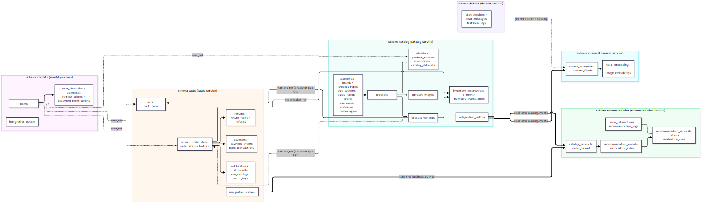
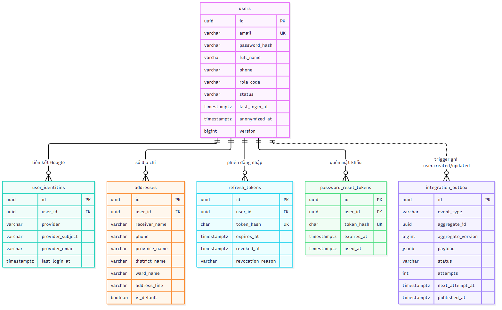
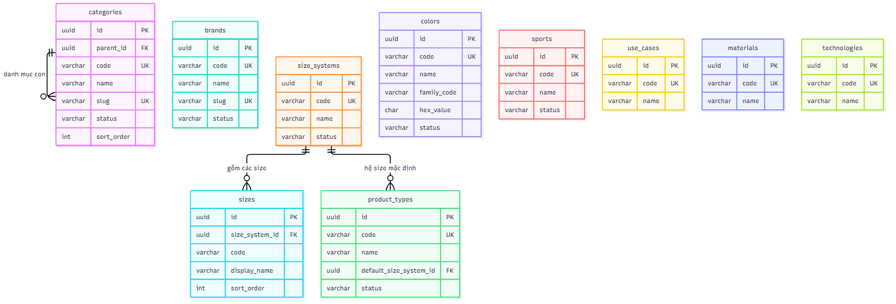
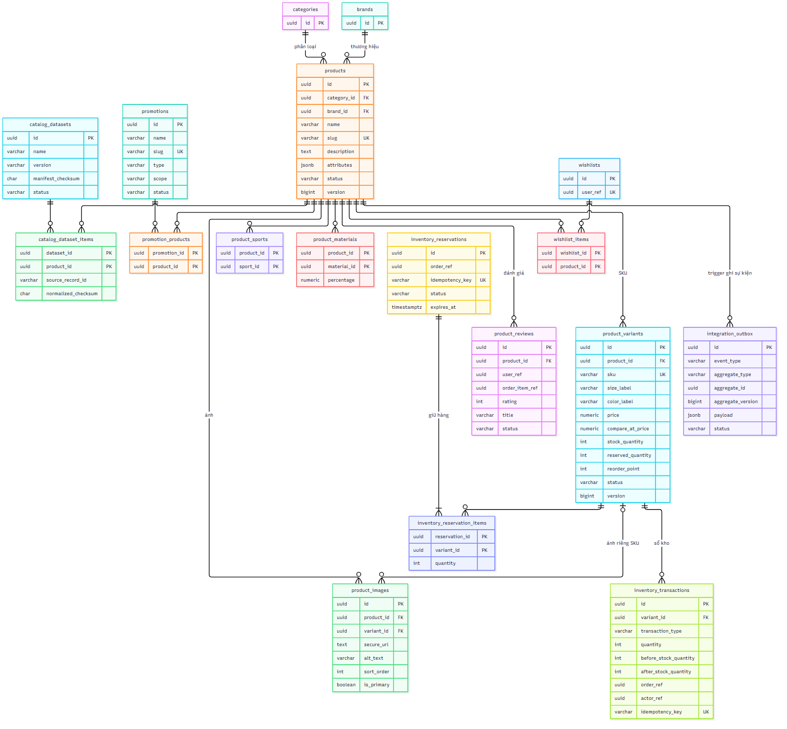
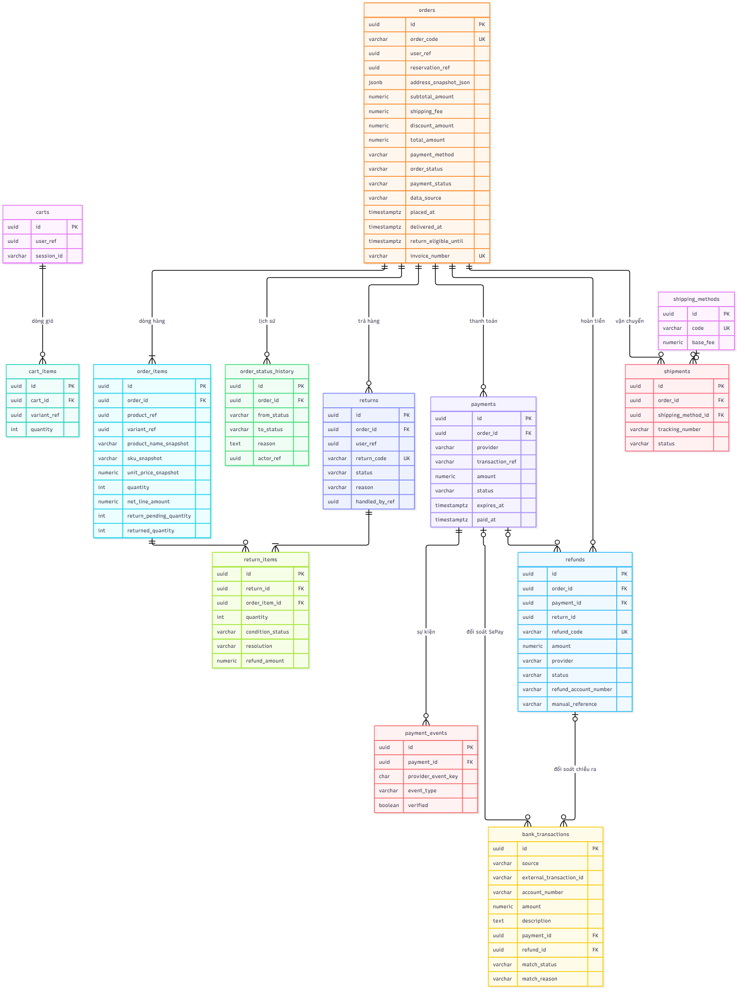
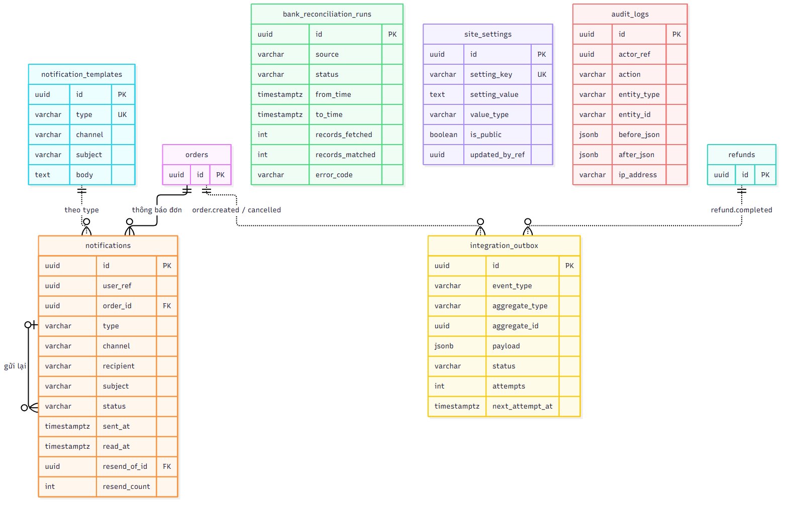
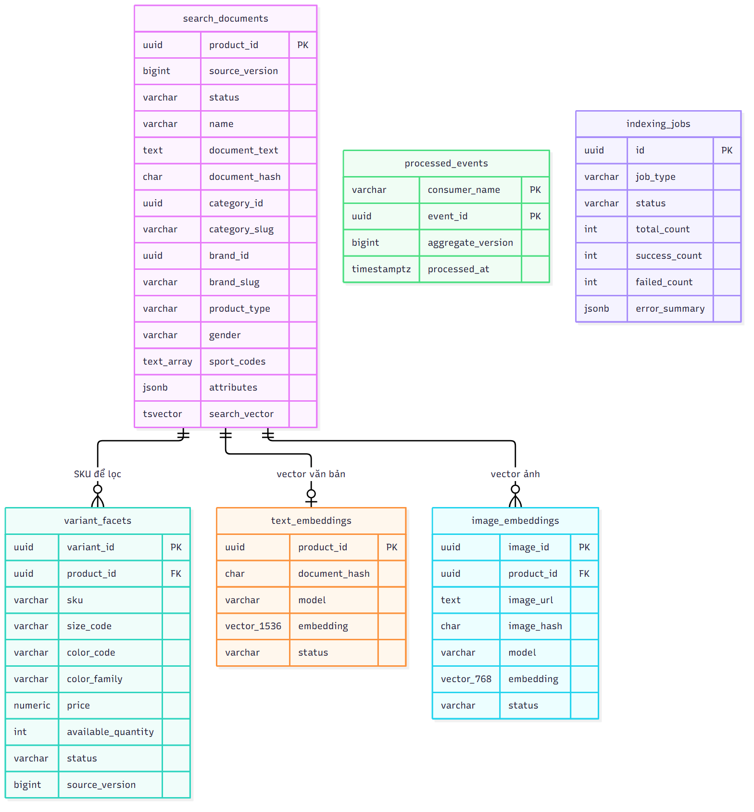
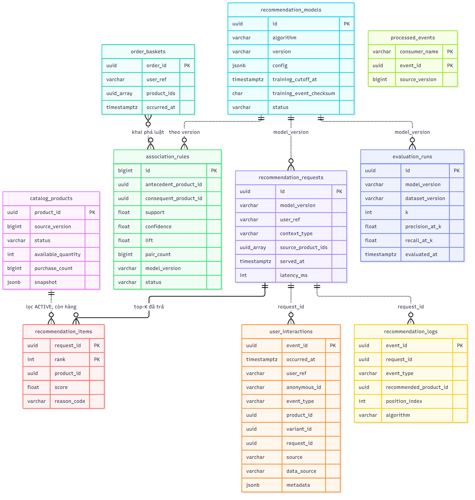
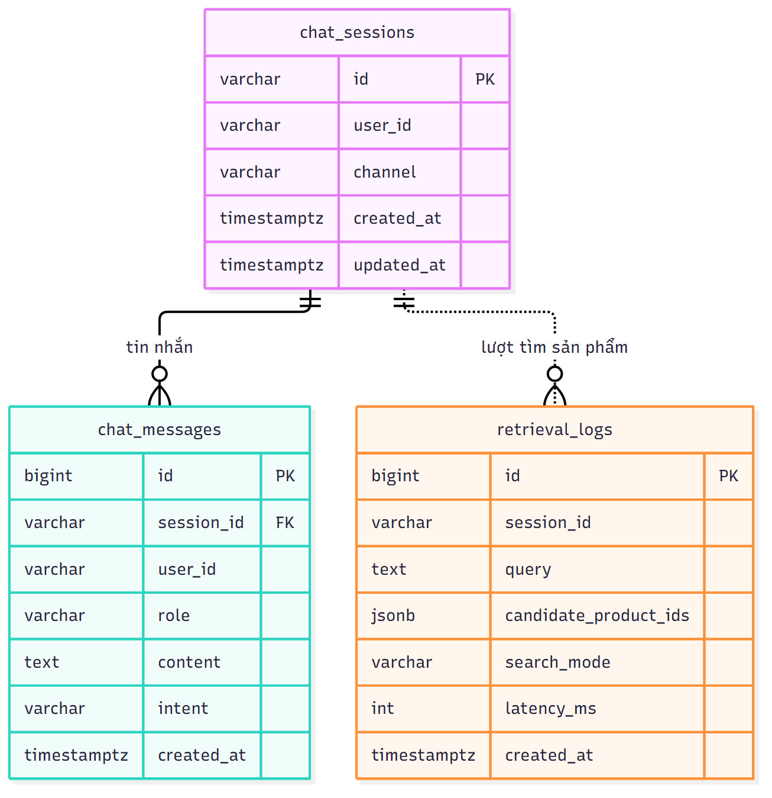

# Database Structure — Cấu trúc cơ sở dữ liệu và ERD

> **Cập nhật 16/11/2026, theo code nhánh `main` sau khi tách microservice.**
>
> **Nguồn sự thật:** migration của từng service:
> - `identity-service/src/main/resources/db/migration/` (V1, V2)
> - `catalog-service/src/main/resources/db/migration/` (V1 → V5)
> - `sales-service/src/main/resources/db/migration/` (V1 → V3)
> - `services/search-service/migrations/` (V1, V2)
> - `chatbot-service/migrations/` (V1)
> - `recommendation-service/migrations/` (V1, V2)
> - `infra/database/phase10/` (V1 phân quyền, V2 bỏ khóa ngoại chéo service, V3 xóa cấu trúc cũ)
>
> Các sơ đồ là ảnh PNG xuất từ mã nguồn **Mermaid** trong `docs/overview/erd/*.mmd` (kèm bản SVG). Muốn sửa sơ đồ: sửa file `.mmd` rồi xuất lại bằng `mmdc -i <file>.mmd -o <file>.png -b white -s 2`.

---

## 0. Thay đổi lớn so với bản trước

| Trước (monolith) | Bây giờ (microservice) |
|---|---|
| Một backend Spring Boot `:8082` dùng chung schema `public` (39 bảng) và schema `ai_retrieval` (8 bảng) | **Sáu service, mỗi service sở hữu một schema riêng** trên cùng một project Supabase |
| Migration Flyway `backend/.../db/v2-migration` (V1 → V7) | Mỗi service có thư mục migration riêng. Runtime **luôn tắt Flyway**; migration chạy bằng script bảo trì có kiểm soát |
| Có khóa ngoại giữa mọi bảng (`orders.user_id → users.id`...) | **Không có khóa ngoại giữa hai schema khác nhau.** Cột tham chiếu sang service khác có hậu tố `_ref` (`user_ref`, `variant_ref`, `product_ref`...) và chỉ là UUID logic |
| `public.*` và `ai_retrieval.*` | **Đã xóa.** Script `infra/database/phase10/V3__retire_legacy_structures.sql` chạy trên Supabase lúc 11/11/2026 12:30 UTC (`docs/microservice-phase-10-database-cleanup.md`). Dữ liệu cũ đã được chép sang schema mới bằng các migration `V2__backfill_*` trước đó |
| Thanh toán VNPAY | Thanh toán **COD** và **VietQR** (chuyển khoản), xác nhận tự động qua webhook **SePay** |
| Embedding văn bản BGE-M3 (1024 chiều) chạy local | Embedding văn bản **OpenAI `text-embedding-3-small` (1536 chiều)**; ảnh vẫn **SigLIP2 (768 chiều)** |
| Bảng recommendation chỉ là bản nháp V10 (chưa chạy) | Schema `recommendation` **đã có và đang chạy** (luật kết hợp + độ phổ biến) |
| Schema `evaluation` dùng chung (dự kiến) | Không tạo. Recommendation lưu kết quả đánh giá trong `recommendation.evaluation_runs` |

---

## 1. Cách đọc tài liệu

**Ký hiệu trong sơ đồ ERD:**

| Ký hiệu | Ý nghĩa |
|---|---|
| `\|\|--o{` | 1 – nhiều |
| `\|\|--o\|` | 1 – 0..1 |
| `..` (nét đứt) | Liên kết **logic**, không có khóa ngoại trong DB |
| `PK` / `FK` / `UK` | Khóa chính / khóa ngoại / ràng buộc duy nhất |

**Quy ước chung** (không lặp lại ở từng bảng):

| Field | Ý nghĩa |
|---|---|
| `id uuid` | Khóa chính. Phần lớn sinh bằng `gen_random_uuid()`; một số bảng (orders, payments...) do code Java tự sinh UUID. |
| `created_at`, `updated_at` | Thời điểm tạo và sửa gần nhất. **Không còn trigger `set_updated_at()`**; code tự cập nhật `updated_at`. |
| `*_ref uuid` | Tham chiếu tới bản ghi thuộc **service khác** (không có FK). Ví dụ `sales.orders.user_ref` = `identity.users.id`. |
| `*_snapshot` | Bản sao giá trị lúc giao dịch, để lịch sử không đổi khi catalog đổi. |
| `version bigint` | Số phiên bản của bản ghi, tăng khi sửa. Bên nhận sự kiện dùng để bỏ qua sự kiện cũ. |
| `data_source` | `REAL` / `DEMO` / `SYNTHETIC`. |
| `*_hash`, `*_checksum` `char(64)` | SHA-256 dạng hex. |

**Thông tin hệ thống:**
- **DBMS:** PostgreSQL trên Supabase; extension `pgvector` nằm trong schema `extensions` (chỉ `search_app` được dùng).
- **Truy cập dữ liệu:** các service Java dùng `JdbcClient`/`JdbcTemplate` (SQL viết tay), không dùng JPA entity. Các service Python dùng `psycopg`/`asyncpg`.
- **Tiền:** `numeric(14,2)`, đơn vị VND.

### 1.1. Mô hình phân quyền theo schema

File `infra/database/phase10/ownership.json` định nghĩa cho mỗi service hai role:

| Service | Schema | Role sở hữu (chạy migration) | Role runtime (service dùng khi chạy) |
|---|---|---|---|
| identity-service | `identity` | `identity_owner` | `identity_app` |
| catalog-service | `catalog` | `catalog_owner` | `catalog_app` |
| sales-service | `sales` | `sales_owner` | `sales_app` |
| search-service | `ai_search` | `search_owner` | `search_app` (+ `extensions`) |
| chatbot-service | `chatbot` | `chatbot_owner` | `chatbot_app` |
| recommendation-service | `recommendation` | `recommendation_owner` | `recommendation_app` |

- Role runtime chỉ có `SELECT/INSERT/UPDATE/DELETE` trong schema của mình và bị `REVOKE` quyền trên `public`. Vì vậy một service **không thể** đọc hay ghi bảng của service khác, kể cả khi code có lỗi.
- Muốn lấy dữ liệu của service khác thì phải gọi **API nội bộ** (`/internal/v1/...`, header `X-Internal-Service-Token`) hoặc nhận **sự kiện** qua RabbitMQ.
- Mỗi service có script `verify_schema_permissions` / permission probe để kiểm tra điều này.

---

## 2. Danh sách bảng

| Schema | Service | Nhóm | Bảng | Số bảng |
|---|---|---|---|---|
| `identity` | Identity | Tài khoản | `users`, `user_identities`, `addresses`, `refresh_tokens`, `password_reset_tokens`, `integration_outbox` | 6 |
| `catalog` | Catalog | Danh mục tra cứu | `categories`, `brands`, `product_types`, `size_systems`, `sizes`, `colors`, `sports`, `use_cases`, `materials`, `technologies` | 10 |
| `catalog` | Catalog | Sản phẩm | `products`, `product_variants`, `product_images`, `product_sports`, `product_use_cases`, `product_materials`, `product_technologies` | 7 |
| `catalog` | Catalog | Kho | `inventory_reservations`, `inventory_reservation_items`, `inventory_transactions` | 3 |
| `catalog` | Catalog | Khác | `wishlists`, `wishlist_items`, `product_reviews`, `promotions`, `promotion_products`, `catalog_datasets`, `catalog_dataset_items`, `integration_outbox` | 8 |
| `sales` | Sales | Giỏ, đơn hàng | `carts`, `cart_items`, `orders`, `order_items`, `order_status_history` | 5 |
| `sales` | Sales | Thanh toán, trả hàng | `payments`, `payment_events`, `bank_transactions`, `bank_reconciliation_runs`, `returns`, `return_items`, `refunds` | 7 |
| `sales` | Sales | Vận chuyển, vận hành | `shipping_methods`, `shipments`, `notifications`, `notification_templates`, `site_settings`, `audit_logs`, `integration_outbox` | 7 |
| `ai_search` | Search | Tìm kiếm | `search_documents`, `variant_facets`, `text_embeddings`, `image_embeddings`, `processed_events`, `indexing_jobs` | 6 |
| `chatbot` | Chatbot | Hội thoại | `chat_sessions`, `chat_messages`, `retrieval_logs` | 3 |
| `recommendation` | Recommendation | Gợi ý | `catalog_products`, `order_baskets`, `user_interactions`, `recommendation_models`, `association_rules`, `recommendation_requests`, `recommendation_items`, `recommendation_logs`, `processed_events`, `evaluation_runs` | 10 |

**Tổng cộng:** 72 bảng trong 6 schema. Schema `public` và `ai_retrieval` không còn bảng nghiệp vụ nào.

---

## 3. Sơ đồ tổng quan

Sơ đồ chỉ có tên bảng. Đường nét liền là khóa ngoại trong cùng schema; nét đứt là tham chiếu logic giữa các service; nét đậm là luồng sự kiện qua RabbitMQ.

Mã nguồn sơ đồ: [`erd/00-tong-quan.mmd`](erd/00-tong-quan.mmd) · Bản vector: [`00-tong-quan.svg`](erd/00-tong-quan.svg)

**Luồng dữ liệu chính:**
1. Admin tạo `catalog.products` → `product_variants` (SKU) → `product_images`.
2. Khách thêm SKU vào `sales.carts`. Sales hỏi Catalog qua API để lấy giá và tồn kho, **không lưu giá trong giỏ**.
3. Khi đặt hàng, Sales nhờ Catalog giữ hàng (`inventory_reservations`), rồi tạo `sales.orders` + `order_items` (có snapshot tên, SKU, giá) và `payments`.
4. Mỗi thay đổi sản phẩm/tồn kho được Catalog ghi vào `catalog.integration_outbox` → RabbitMQ → Search dựng lại `ai_search.search_documents` và embedding.
5. Đơn hàng mới được Sales ghi vào `sales.integration_outbox` → RabbitMQ → Recommendation ghi `order_baskets` để khai phá luật "thường mua cùng".

---

## 4. Schema `identity` — Tài khoản

Mã nguồn sơ đồ: [`erd/01-identity.mmd`](erd/01-identity.mmd) · Bản vector: [`01-identity.svg`](erd/01-identity.svg)

### `users` — Tài khoản (khách và nhân viên)
| Field | Kiểu | Ý nghĩa |
|---|---|---|
| `email` | varchar(255), UK | Email đăng nhập; CHECK luôn là chữ thường, đã cắt khoảng trắng. |
| `password_hash` | varchar(255) | Mật khẩu băm BCrypt. `NULL` nếu chỉ đăng nhập Google. |
| `full_name`, `phone` | varchar | Họ tên, số điện thoại. |
| `role_code` | varchar(30) | `CUSTOMER`, `SALES_STAFF`, `WAREHOUSE_STAFF`, `ADMIN`. |
| `status` | varchar(20) | `ACTIVE`, `LOCKED`, `DEACTIVATED`. |
| `last_login_at`, `anonymized_at` | timestamptz | Lần đăng nhập gần nhất; thời điểm xóa thông tin cá nhân. |
| `version` | bigint | Phiên bản bản ghi, đưa vào sự kiện `identity.user.*`. |

Trigger `trg_identity_user_event`: mỗi lần thêm user hoặc sửa `full_name`, `phone`, `role_code`, `status` thì ghi một sự kiện `identity.user.created.v1` / `identity.user.updated.v1` vào `integration_outbox`.

### `user_identities` — Đăng nhập Google
| Field | Ý nghĩa |
|---|---|
| `user_id` | FK → `users`, xóa user thì xóa theo. |
| `provider` | Chỉ có `GOOGLE`. |
| `provider_subject` | Claim `sub` của Google. UK `(provider, provider_subject)` và UK `(user_id, provider)`. |
| `provider_email`, `last_login_at` | Email Google lúc liên kết; lần đăng nhập gần nhất. |

### `addresses` — Sổ địa chỉ
| Field | Ý nghĩa |
|---|---|
| `receiver_name`, `phone` | Người nhận. |
| `province_name`, `district_name` (tùy chọn), `ward_name`, `address_line` | Địa chỉ. **Bản mới chỉ lưu tên**, không còn các cột `*_code`. |
| `is_default` | Mỗi user tối đa 1 địa chỉ mặc định (unique index một phần `uq_identity_default_address`). |

Sales không đọc bảng này trực tiếp mà gọi `GET /internal/v1/users/{userId}/addresses/{addressId}` rồi lưu bản sao vào `orders.address_snapshot_json`.

### `refresh_tokens` / `password_reset_tokens`
| Field | Ý nghĩa |
|---|---|
| `token_hash` | `char(64)`, UK: SHA-256 của token. **Không lưu token gốc.** |
| `expires_at` | Hạn dùng. |
| `revoked_at`, `revocation_reason` | (refresh) Thời điểm và lý do thu hồi: `ROTATED` khi đổi token, `REUSE_DETECTED` khi token đã thu hồi bị dùng lại (thu hồi mọi phiên của user)... |
| `used_at` | (reset) Mỗi token đặt lại mật khẩu chỉ dùng một lần. |

### `integration_outbox` (identity)
Hàng đợi sự kiện của Identity. `IdentityOutboxRelay` đẩy lên exchange `identity.events`. Hiện **chưa có queue nào bind** vào exchange này (`rabbitmq/definitions.json`), tức là chưa service nào tiêu thụ sự kiện user.

---

## 5. Schema `catalog` — Danh mục tra cứu

Mã nguồn sơ đồ: [`erd/02-catalog-danh-muc.mmd`](erd/02-catalog-danh-muc.mmd) · Bản vector: [`02-catalog-danh-muc.svg`](erd/02-catalog-danh-muc.svg)

| Bảng | Lưu gì | Field đặc thù |
|---|---|---|
| `categories` | Danh mục dạng cây. | `parent_id` (FK tự trỏ), `code` UK, `slug` UK, `sort_order`, `status`. |
| `brands` | Thương hiệu. | `code` UK, `slug` UK. |
| `size_systems` / `sizes` | Hệ size (`APPAREL_INT`, `SHOES_EU`, `ONE_SIZE`) và size trong từng hệ. | `sizes`: UK `(size_system_id, code)`, `display_name`, `sort_order`. |
| `product_types` | Loại sản phẩm (`SPORTS_TOP`, `SPORTS_SHOES`...). | `default_size_system_id`. |
| `colors` | Màu chuẩn. | `family_code` (nhóm màu), `hex_value`. |
| `sports`, `use_cases`, `materials`, `technologies` | Môn thể thao, mục đích, chất liệu, công nghệ. | `code` UK. |

> **Lưu ý:** các bảng `size_systems`, `sizes`, `product_types`, `colors`, `sports`... được chép nguyên từ schema cũ (migration `V3__complete_legacy_catalog_ownership.sql`) để giữ dữ liệu. Nhưng `products` và `product_variants` mới **không còn khóa ngoại** tới chúng (xem mục 6). Hiện chúng là bảng tham khảo.

---

## 6. Schema `catalog` — Sản phẩm, kho và dữ liệu phụ

Mã nguồn sơ đồ: [`erd/03-catalog-san-pham.mmd`](erd/03-catalog-san-pham.mmd) · Bản vector: [`03-catalog-san-pham.svg`](erd/03-catalog-san-pham.svg)

### `products` — Sản phẩm
| Field | Kiểu | Ý nghĩa |
|---|---|---|
| `category_id`, `brand_id` | uuid, FK | Danh mục, thương hiệu. |
| `name`, `slug` (UK), `description` | | Tên, đường dẫn, mô tả. |
| `attributes` | jsonb | **Chứa các thuộc tính trước đây là cột riêng**: `gender`, `sportType` / `sportCodes`, `productType`, `shortDescription`, `isFeatured`... |
| `status` | varchar(20) | `DRAFT`, `ACTIVE`, `INACTIVE`. |
| `version` | bigint | Tăng mỗi lần sửa (thay cho `catalog_version` cũ). Đi kèm sự kiện dưới tên `sourceVersion`. |

Trigger `trg_catalog_product_changed`: mỗi `INSERT`/`UPDATE` trên `products` ghi một sự kiện `PRODUCT_REINDEX_REQUESTED` vào `integration_outbox`.

### `product_variants` — SKU
| Field | Ý nghĩa |
|---|---|
| `sku` | UK. |
| `size_label`, `color_label` | **Chữ** hiển thị size và màu (vd `M`, `Đen`). Thay cho `size_id`/`color_id` cũ. |
| `price`, `compare_at_price` | Giá bán (CHECK > 0) và giá gốc. **Nguồn giá chuẩn duy nhất.** |
| `stock_quantity`, `reserved_quantity` | Tồn vật lý và số đang giữ. CHECK `0 ≤ reserved ≤ stock`. **Khả dụng = stock − reserved.** |
| `reorder_point`, `status`, `version` | Ngưỡng cảnh báo, trạng thái, phiên bản. |

Trigger `trg_catalog_inventory_changed`: khi `stock_quantity` hoặc `reserved_quantity` đổi thì cũng ghi `PRODUCT_REINDEX_REQUESTED` cho sản phẩm cha (để Search cập nhật tồn kho trong `variant_facets`).

### `product_images`
`product_id` (FK), `variant_id` (FK, tùy chọn), `secure_url`, `alt_text`, `sort_order`, `is_primary`. Bản mới **không còn** `public_id`, `asset_version`, `source_kind`, `license_code`.

### Bảng nối
`product_sports`, `product_use_cases`, `product_materials` (`percentage`), `product_technologies`: chép từ schema cũ.

### Kho: `inventory_reservations`, `inventory_reservation_items`, `inventory_transactions`
| Bảng | Field | Ý nghĩa |
|---|---|---|
| `inventory_reservations` | `order_ref` | Đơn hàng (bên Sales) đang giữ hàng. |
| | `idempotency_key` | UK. Sales gửi lại cùng key thì nhận lại đúng phiếu cũ, không giữ hàng hai lần. |
| | `status` | `ACTIVE` → `CONFIRMED` (trừ kho thật) hoặc `RELEASED` (nhả hàng); `EXPIRED`. |
| | `expires_at` | Hết hạn sau 900 giây (15 phút) kể từ lúc tạo. |
| `inventory_reservation_items` | `variant_id`, `quantity` | Số lượng giữ cho từng SKU. PK `(reservation_id, variant_id)`. |
| `inventory_transactions` | `transaction_type`, `quantity`, `idempotency_key` (UK) | Sổ kho cho nhập/xuất/điều chỉnh thủ công của admin. |
| | `before/after_stock_quantity`, `before/after_reserved_quantity`, `order_ref`, `return_ref`, `actor_ref`, `reason` | Thêm ở V3 để giữ đủ thông tin của sổ kho cũ. |

### Khác
| Bảng | Ý nghĩa |
|---|---|
| `wishlists` / `wishlist_items` | Danh sách yêu thích. `wishlists.user_ref` UK (mỗi user một danh sách). |
| `product_reviews` | Đánh giá 1–5 sao. `user_ref`, `order_item_ref`, `status` (`PENDING`/`APPROVED`...). UK `(user_ref, product_id)`: mỗi khách một đánh giá cho một sản phẩm. Trước khi cho viết, Catalog hỏi Sales `GET /internal/v1/reviews/eligibility` (khách phải có đơn `DELIVERED` chứa sản phẩm đó). |
| `promotions` / `promotion_products` | Khuyến mãi (`type`, `scope`, % hoặc số tiền, thời gian, giới hạn lượt dùng). |
| `catalog_datasets` / `catalog_dataset_items` | Bộ dữ liệu catalog đã import (`manifest_checksum`, `normalized_checksum`) để tái lập dữ liệu. |
| `integration_outbox` | Sự kiện của Catalog, xem mục 10. |

---

## 7. Schema `sales` — Giỏ hàng, đơn hàng, thanh toán, trả hàng

Mã nguồn sơ đồ: [`erd/04-sales-don-hang-thanh-toan.mmd`](erd/04-sales-don-hang-thanh-toan.mmd) · Bản vector: [`04-sales-don-hang-thanh-toan.svg`](erd/04-sales-don-hang-thanh-toan.svg)

### `carts` / `cart_items`
| Field | Ý nghĩa |
|---|---|
| `carts.user_ref` | Giỏ của user đã đăng nhập (unique index một phần). |
| `carts.session_id` | Giỏ của khách vãng lai, lấy từ cookie `session_id` (HttpOnly, 30 ngày). CHECK **đúng một trong hai** `user_ref` / `session_id`. |
| `cart_items.variant_ref` | SKU (bên Catalog). UK `(cart_id, variant_ref)`. |
| `cart_items.quantity` | > 0. **Không lưu giá**; mỗi lần đọc giỏ, Sales gọi Catalog lấy giá mới nhất. |

> Code hiện tại **chưa có bước gộp giỏ** khách vãng lai vào giỏ tài khoản khi đăng nhập (bản monolith cũ có `CartMergeService`).

### `orders`
| Field | Ý nghĩa |
|---|---|
| `order_code` | UK, dạng `ORD-` + 8 ký tự đầu của id. |
| `user_ref`, `reservation_ref` | Người đặt (Identity) và phiếu giữ hàng (Catalog). |
| `address_snapshot_json` | Bản sao địa chỉ lúc đặt. |
| `subtotal_amount`, `shipping_fee`, `discount_amount`, `total_amount` | CHECK `total = subtotal + shipping − discount`. |
| `payment_method` | **`COD`** hoặc **`VIETQR`**. |
| `order_status` | `PENDING_CONFIRMATION` → `CONFIRMED` → `PACKING` → `SHIPPING` → `DELIVERED`; hoặc `CANCELLED`. |
| `payment_status` | `UNPAID`, `PENDING`, `PAID`, `FAILED`, `CANCELLED`, `PARTIALLY_REFUNDED`, `REFUNDED`. |
| `cancellation_requested_by` / `_reason` / `_at` | `CUSTOMER`, `STAFF` hoặc `SYSTEM` (lỗi xác nhận giữ hàng). |
| `placed_at`, `delivered_at`, `return_eligible_until` | Thời điểm đặt, giao, hạn trả hàng. |
| `invoice_number` | UK, lấy từ sequence `orders_invoice_number_seq`. |
| `data_source` | Báo cáo doanh thu chỉ tính `REAL`. |

### `order_items`
`product_ref`, `variant_ref`, `product_name_snapshot`, `sku_snapshot`, `size_snapshot`, `color_snapshot`, `unit_price_snapshot`, `quantity`, `line_total` (CHECK = đơn giá × số lượng), `discount_allocated`, `net_line_amount` (CHECK = line_total − discount), `return_pending_quantity`, `returned_quantity`.

### `order_status_history`
`from_status` → `to_status`, `reason`, `actor_ref`, `occurred_at`. Ghi lúc tạo đơn (`ORDER_CREATED`), lúc admin đổi trạng thái và lúc hủy.

### `payments` / `payment_events`
| Field | Ý nghĩa |
|---|---|
| `payments.provider` | `COD` hoặc `BANK_TRANSFER` (VietQR). |
| `payments.transaction_ref` | COD: `COD-<orderId>`. VietQR: **`DH` + 10 ký tự** từ id đơn. Đây là nội dung khách ghi khi chuyển khoản. UK `(provider, transaction_ref)`. |
| `payments.status` | `UNPAID` (COD), `PENDING` (VietQR chờ tiền), `PAID`, `CANCELLED`, ... |
| `payments.expires_at` | Hạn chuyển khoản VietQR, mặc định 900 giây (`VIETQR_PAYMENT_TTL_SECONDS`). |
| `payment_events.provider_event_key` | SHA-256 của `SEPAY|<id giao dịch>`, UK `(provider, provider_event_key)` để chống ghi trùng. |

### `bank_transactions` — Giao dịch ngân hàng nhận từ SePay
| Field | Ý nghĩa |
|---|---|
| `source`, `external_transaction_id` | UK `(source, external_transaction_id)`: SePay gửi lại cùng giao dịch thì không xử lý lần hai. |
| `account_number`, `amount`, `description`, `transaction_time` | Tài khoản nhận, số tiền (âm nếu tiền ra), nội dung, thời gian. |
| `payment_id` / `refund_id` | Thanh toán hoặc lệnh hoàn tiền đã khớp. |
| `match_status`, `match_reason` | `MATCHED`, `UNMATCHED`, `AMOUNT_MISMATCH`, `LATE_PAYMENT`, `MANUAL_REVIEW`, `IGNORED_OUTGOING`... Giao dịch không khớp **được giữ lại để đối soát tay** và không bao giờ tự đánh dấu đơn đã trả tiền. |

### `returns` / `return_items` / `refunds`
| Bảng | Field chính |
|---|---|
| `returns` | `return_code` (`RET` + 12 ký tự), `status`: `REQUESTED` → `APPROVED` → `RECEIVED` → `REFUNDED`, hoặc `REJECTED` / `CANCELLED`. `handled_by_ref`. |
| `return_items` | `order_item_id` (khóa ngoại kép kèm `order_id`), `quantity`, `condition_status`, `resolution` (`REFUND`/`REJECT`), `refund_amount`, `restocked`. |
| `refunds` | `refund_code` (`RFD` + 13 số), `amount`, `provider` (`COD`, `BANK_TRANSFER`, `MANUAL`), `status`: `PENDING`, `PROCESSING`, `COMPLETED`, `FAILED`, `CANCELLED`. Tài khoản nhận hoàn: `refund_bank_code`, `refund_bank_name`, `refund_account_number`, `refund_account_name`. Hoàn tay: `manual_reference`, `manual_note`. |

### `shipping_methods` / `shipments`
Phương thức vận chuyển (`code`, `base_fee`) và vận đơn (`carrier`, `tracking_number`, `status`). Đã có bảng; checkout hiện đặt phí ship = 0.

---

## 8. Schema `sales` — Vận hành

Mã nguồn sơ đồ: [`erd/05-sales-van-hanh.mmd`](erd/05-sales-van-hanh.mmd) · Bản vector: [`05-sales-van-hanh.svg`](erd/05-sales-van-hanh.svg)

| Bảng | Ý nghĩa |
|---|---|
| `notifications` | Thông báo gửi khách (`type`, `channel` mặc định `EMAIL`, `recipient`, `status`, `read_at`). Có gửi lại (`resend_of_id`, `resend_count`). Storefront đọc qua `/api/v1/notifications/me` và luồng SSE. |
| `notification_templates` | Mẫu nội dung theo `type`. |
| `bank_reconciliation_runs` | Mỗi lần chạy đối soát SePay: khoảng thời gian, số giao dịch lấy về / chèn / khớp, lỗi. |
| `site_settings` | Cấu hình website (`setting_key` UK, `value_type`, `is_public`). Storefront đọc `/api/v1/settings/public`. |
| `audit_logs` | Nhật ký thao tác quản trị (`actor_ref`, `action`, `entity_type`, `entity_id`, `before_json`, `after_json`, IP, user agent). |
| `integration_outbox` | Sự kiện Sales: `sales.order.created.v1`, `sales.order.cancelled.v1`, `sales.payment.completed.v1`, `sales.refund.completed.v1`. Retry tối đa 8 lần với thời gian chờ tăng dần (≤ 1 giờ) rồi `FAILED`. |

> Trước đây `site_settings` và `audit_logs` thuộc nhóm "Hệ thống" dùng chung. Khi tách service, chúng được giao cho Sales (`V3__complete_legacy_sales_ownership.sql`).

---

## 9. Schema `ai_search` — Tìm kiếm (search-service)

Schema chỉ chứa **dữ liệu dẫn xuất**: luôn dựng lại được từ Catalog (API `GET /internal/v1/products/{id}/index-document` + sự kiện). Không có SQL nào đọc bảng của Catalog.

Mã nguồn sơ đồ: [`erd/06-ai-search.mmd`](erd/06-ai-search.mmd) · Bản vector: [`06-ai-search.svg`](erd/06-ai-search.svg)

### `search_documents` — Bản đọc sản phẩm
| Field | Ý nghĩa |
|---|---|
| `product_id` | = `catalog.products.id` (không FK). |
| `source_version` | `version` của sản phẩm lúc index. Snapshot cũ hơn sự kiện thì báo lỗi để thử lại. |
| `status` | `ACTIVE`, `INACTIVE`, `DELETED`, `DRAFT`. |
| `document_text`, `document_hash` | Văn bản tổng hợp để embed và tìm từ khóa; hash để biết có cần embed lại. |
| `category_id/slug`, `brand_id/slug`, `product_type`, `gender`, `sport_codes`, `attributes` | Bản sao thuộc tính để lọc nhanh. |
| `search_vector` | `tsvector` tự sinh từ `name + document_text` (cấu hình `simple`), index GIN. |

### `variant_facets`
SKU để lọc: `size_code`, `color_code`, `color_family`, `price`, `available_quantity`, `status`. FK → `search_documents` (`ON DELETE CASCADE`).

### `text_embeddings` / `image_embeddings`
| Field | Ý nghĩa |
|---|---|
| `embedding` | `vector(1536)` cho văn bản (OpenAI `text-embedding-3-small`), `vector(768)` cho ảnh (SigLIP2 `google/siglip2-base-patch16-224`, revision `75de2d55…`). |
| `model` | Tên model đã sinh vector. |
| `document_hash` / `image_hash` | Hash đầu vào lúc embed. |
| `status` | `READY` mới được dùng khi tìm. |
| Index | **HNSW** `vector_cosine_ops` trên cả hai bảng (bản cũ dùng cosine chính xác, không index). |

### `processed_events`, `indexing_jobs`
`processed_events (consumer_name, event_id)`: mỗi sự kiện chỉ xử lý một lần (consumer `catalog-index-v1`). `indexing_jobs`: lô backfill (`scripts/backfill.py`, mặc định chạy thử, cần `--execute` mới ghi).

### Hàm `ai_search.search_text(p_query, p_vector, p_limit, p_filters, ...)`
1. Lọc sản phẩm `ACTIVE` theo bộ lọc (danh mục, thương hiệu, giới tính — `UNISEX` luôn được tính —, môn, loại) và phải có ít nhất một SKU `ACTIVE` thỏa màu, size, khoảng giá, còn hàng.
2. Nhánh **từ khóa**: `search_vector @@ plainto_tsquery`, xếp theo `ts_rank_cd`.
3. Nhánh **ngữ nghĩa**: khoảng cách cosine `<=>`, chỉ giữ độ tương đồng ≥ `0,40`.
4. Gộp bằng **RRF có trọng số**: `score = 1,2 / (60 + rank_keyword) + 1,0 / (60 + rank_semantic)`.

---

## 10. Sự kiện giữa các schema (outbox → RabbitMQ)

| Nguồn | Bảng outbox | Sự kiện (routing key) | Exchange | Queue nhận | Bên xử lý |
|---|---|---|---|---|---|
| Catalog | `catalog.integration_outbox` | `product.reindex.requested` | `catalog.events` | `search.indexing` | Search Worker |
| | | | | `recommendation.events` | Recommendation Worker |
| Sales | `sales.integration_outbox` | `order.created` | `business.events` | `recommendation.events` | Recommendation Worker |
| | | `order.cancelled`, `payment.completed`, `refund.completed` | `business.events` | (chưa có queue bind) | — |
| Identity | `identity.integration_outbox` | `identity.user.*` | `identity.events` | (chưa có queue bind) | — |

Mỗi queue có ba queue retry (`.retry.30s`, `.retry.5m`, `.retry.1h`) và một `.dlq`. Cấu hình trong `rabbitmq/definitions.json`. Hợp đồng sự kiện nằm trong `contracts/*.schema.json`.

---

## 11. Schema `recommendation` — Gợi ý sản phẩm (recommendation-service)

Mã nguồn sơ đồ: [`erd/07-recommendation.mmd`](erd/07-recommendation.mmd) · Bản vector: [`07-recommendation.svg`](erd/07-recommendation.svg)

### Bản đọc nhận từ sự kiện
| Bảng | Field | Ý nghĩa |
|---|---|---|
| `catalog_products` | `product_id` PK, `source_version`, `status`, `available_quantity`, `snapshot` (jsonb: id, name, slug, ảnh, giá min/max...) | Bản sao sản phẩm để **lọc ACTIVE + còn hàng** và trả thông tin hiển thị. Worker dựng snapshot bằng cách gọi API Catalog khi nhận sự kiện sản phẩm, chỉ ghi khi `source_version` không cũ hơn bản đang có. `available_quantity` = tổng tồn khả dụng của các SKU `ACTIVE`. |
| | `purchase_count` | Số đơn chứa sản phẩm. Dùng cho **popularity**. Index một phần `idx_recommendation_catalog_popular (status, purchase_count desc) where available_quantity > 0`. |
| `order_baskets` | `order_id` PK, `user_ref`, `product_ids uuid[]`, `occurred_at` | "Giỏ" của mỗi đơn hàng, đầu vào để khai phá luật kết hợp. Sales gửi ID variant; worker đổi sang ID sản phẩm trước khi lưu. |

### Hành vi người dùng
| Bảng | Ý nghĩa |
|---|---|
| `user_interactions` | Như bảng cũ, nhưng `user_id` đổi thành `user_ref varchar(100)`. `event_type`, `product_id`, `variant_id`, `request_id`, `source`, `data_source` (`REAL`/`DEMO`/`SYNTHETIC`), `metadata` (jsonb object). CHECK phải có `user_ref` hoặc `anonymous_id`. **Chỉ thêm** (trigger chặn `UPDATE`/`DELETE`). Bản mới **không còn CHECK danh sách `event_type`**. Index theo `occurred_at` và `(product_id, occurred_at)`. |
| `recommendation_logs` | Impression/click trên ô gợi ý: `event_type` ∈ `IMPRESSION`, `CLICK`, `ADD_TO_CART`, `PURCHASE`; `recommended_product_id`, `position_index`, `algorithm`, `request_id`. Chỉ thêm. Hiện chỉ có dữ liệu chép từ hệ thống cũ; chưa có API ghi mới. |

### Mô hình và kết quả
| Bảng | Field | Ý nghĩa |
|---|---|---|
| `recommendation_models` | `algorithm`, `version` (UK cùng nhau), `config`, `training_cutoff_at`, `training_event_checksum`, `trained_at`, `status` (`DRAFT`/`ACTIVE`/`ARCHIVED`) | Sổ đăng ký model. Khi rebuild, service ghi `ASSOCIATION_RULE` + version. Hai cột checksum/cutoff đã có nhưng code chưa điền. |
| `association_rules` | `antecedent_product_id` → `consequent_product_id`, `support`, `confidence`, `lift`, `pair_count`, `model_version`, `status` | Luật "mua A thường mua B". UK `(antecedent, consequent, model_version)`. Index một phần cho luật `ACTIVE` sắp theo confidence, lift. |
| `recommendation_requests` | `model_version`, `user_ref`, `context_type` (vd `FREQUENTLY_BOUGHT_TOGETHER`, `CART_RECOMMENDATION`), `source_product_ids uuid[]`, `served_at`, `latency_ms` | Mỗi lần trả gợi ý. |
| `recommendation_items` | PK `(request_id, rank)`, UK `(request_id, product_id)`, `score`, `reason_code` (= `ASSOCIATION_RULE` hoặc `POPULARITY`) | Danh sách đã trả, xóa theo request (`ON DELETE CASCADE`). |
| `evaluation_runs` | `model_version`, `dataset_version`, `k`, `precision_at_k`, `recall_at_k`, `evaluated_at` | Kết quả đánh giá offline (API `POST /internal/v1/evaluations`). Hiện chỉ có Precision@K và Recall@K. |
| `processed_events` | `(consumer_name, event_id)` | Chống xử lý trùng. Consumer `recommendation-events` (sự kiện RabbitMQ) và `interaction-api` (API ghi hành vi). |

---

## 12. Schema `chatbot` — Hội thoại

Mã nguồn sơ đồ: [`erd/08-chatbot.mmd`](erd/08-chatbot.mmd) · Bản vector: [`08-chatbot.svg`](erd/08-chatbot.svg)

| Bảng | Ý nghĩa |
|---|---|
| `chat_sessions` | Phiên chat (`id` varchar do client tạo, `user_id`, `channel` mặc định `web`). |
| `chat_messages` | Tin nhắn: `role` ∈ `user`/`assistant`/`system`, `content`, `intent` đã nhận diện. FK → `chat_sessions` (`ON DELETE CASCADE`). |
| `retrieval_logs` | Mỗi lần chatbot tìm sản phẩm: câu truy vấn, danh sách `candidate_product_ids`, `search_mode`, `latency_ms`. |

Lịch sử ngắn hạn của cuộc hội thoại nằm trong **Redis**; schema `chatbot` là bản lưu bền. Kho tri thức (chính sách, bảng size, FAQ) là 6 file Markdown trong `chatbot-service/knowledge/`, **không** lưu trong DB.

---

## 13. Những gì đã bỏ so với thiết kế V2 cũ

| Thiết kế cũ | Hiện trạng |
|---|---|
| Schema `ai_retrieval` (`embedding_models`, `product_search_documents`, `product_text_embeddings`, `indexing_job_items`, `usage_events`...) và hàm `search_product_*_exact` | Đã xóa (Phase 10 V3). Thay bằng `ai_search`. |
| Trigger nghiệp vụ trong DB: `assert_product_publishable`, `check_variant_size_system`, `validate_inventory_delta`, `reject_fact_mutation` trên sổ kho... | Không có trong schema mới. Kiểm tra nghiệp vụ chuyển vào code service (vd `InventoryReservationService`). Chỉ còn trigger chỉ-thêm trên `recommendation.user_interactions` và `recommendation_logs`. |
| Schema `evaluation` dùng chung (`datasets`, `recommendation_splits`, `evaluation_metrics`...) | Không tạo. Đánh giá tìm ảnh dùng file trong `datasets/image-search/`; recommendation dùng `evaluation_runs`. |
| V8/V9 (knowledge RAG, query analysis) và schema `assistant` | Không tạo. Chatbot dùng schema `chatbot` (3 bảng) và tri thức dạng file. |
| VNPAY (`vnp_TxnRef`, IPN) | Thay bằng VietQR + SePay webhook + `bank_transactions`. |
