# WorkFlow — Luồng hoạt động của hệ thống microservice

> **Cập nhật 16/11/2026, theo code nhánh `main`; mục 10–11 cập nhật 17/11/2026 theo nhánh `quyen`.** Backend monolith `:8082` đã bị gỡ bỏ; mọi request từ frontend đi qua **API Gateway `:8085`** rồi tới một trong sáu service.
>
> Các sơ đồ là ảnh PNG xuất từ mã nguồn **Mermaid** trong `docs/overview/workflow/*.mmd` (kèm SVG). Muốn sửa: sửa file `.mmd` rồi chạy `mmdc -i <file>.mmd -o <file>.png -b white -s 2`.

---

## 1. Kiến trúc tổng thể

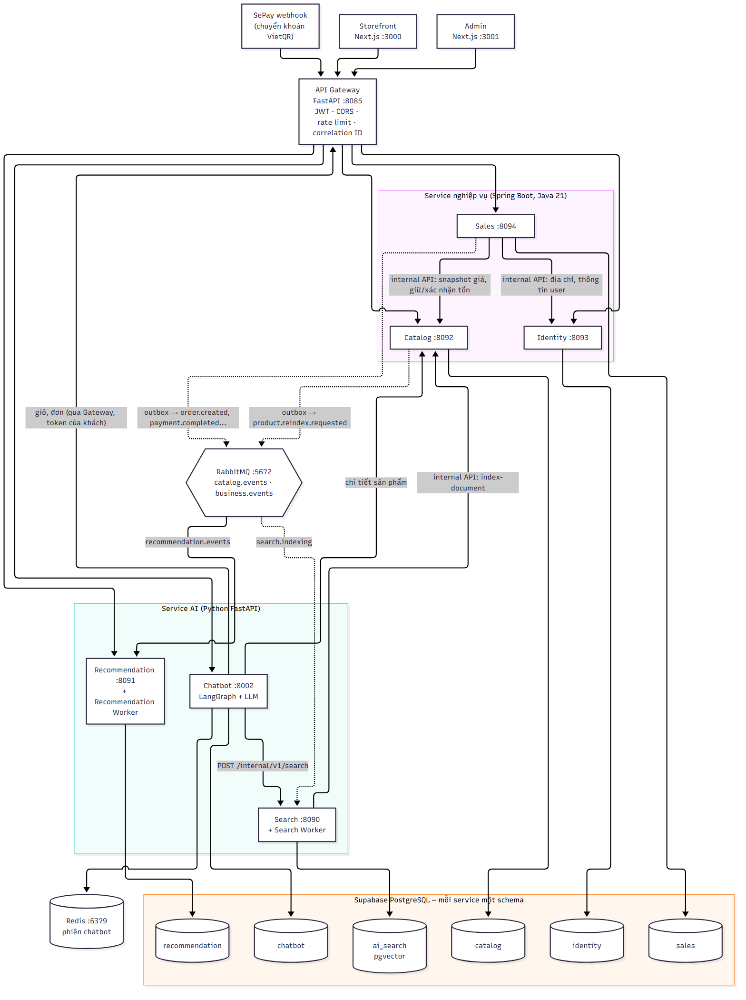

Mã nguồn sơ đồ: [`workflow/01-kien-truc-tong-the.mmd`](workflow/01-kien-truc-tong-the.mmd) · Bản vector: [`01-kien-truc-tong-the.svg`](workflow/01-kien-truc-tong-the.svg)

| Thành phần | Công nghệ | Port | Việc chính |
|---|---|---|---|
| Storefront / Admin | Next.js | 3000 / 3001 | Giao diện; **chỉ gọi Gateway** (kể cả chatbot) |
| Gateway | FastAPI + HTTPX | 8085 | Định tuyến, kiểm tra JWT, CORS, rate limit, correlation ID, metrics |
| Identity | Spring Boot 3.5, Java 21 | 8093 | Tài khoản, JWT, Google login, sổ địa chỉ |
| Catalog | Spring Boot | 8092 | Sản phẩm, danh mục, tồn kho, giữ hàng, wishlist, đánh giá |
| Sales | Spring Boot | 8094 | Giỏ hàng, checkout, đơn hàng, VietQR/SePay, trả hàng, hoàn tiền, báo cáo |
| Search (+ worker) | FastAPI, pgvector | 8090 | Tìm kiếm hybrid và tìm ảnh, dựng index từ sự kiện |
| Recommendation (+ worker) | FastAPI, psycopg | 8091 | Gợi ý "thường mua cùng", popularity, ghi hành vi |
| Chatbot | FastAPI, LangGraph, Claude/OpenAI | 8002 | Tư vấn bán hàng bằng hội thoại |
| Hạ tầng | Supabase PostgreSQL, Redis, RabbitMQ | 6379, 5672 | Dữ liệu, phiên chatbot, sự kiện |

**Nguyên tắc:**
- Mỗi service chỉ đọc/ghi **schema của mình** (DB chặn bằng quyền của role runtime).
- Service cần dữ liệu của service khác thì gọi **API nội bộ** `/internal/v1/...` với header `X-Internal-Service-Token`. Gateway chặn mọi đường dẫn `/internal/**` từ bên ngoài.
- Thay đổi cần lan truyền (sản phẩm đổi, đơn mới) đi qua **outbox → RabbitMQ**, không gọi đồng bộ.
- Catalog là nguồn chuẩn của giá và tồn kho; Sales là nguồn chuẩn của đơn hàng và tiền.

Chạy toàn bộ ở local: `.\scripts\run\start-all-local.cmd` (chi tiết trong `RUN_LOCAL.md`). Cờ `-NoAi` bỏ Search, Recommendation, Chatbot.

---

## 2. Luồng chung của một request

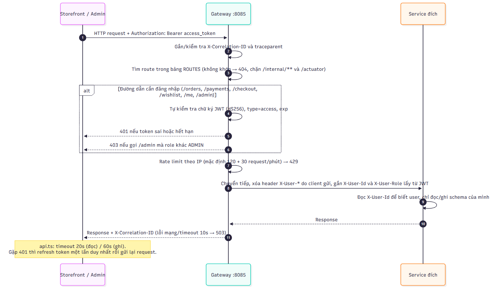

Mã nguồn sơ đồ: [`workflow/02-luong-request-chung.mmd`](workflow/02-luong-request-chung.mmd) · Bản vector: [`02-luong-request-chung.svg`](workflow/02-luong-request-chung.svg)

**Chi tiết (file `gateway/app/main.py`):**
- Bảng `ROUTES` quyết định đường dẫn nào đi tới service nào. Đường dẫn không có trong bảng trả 404.
- Gateway **tự kiểm tra chữ ký JWT** bằng `JWT_ACCESS_SECRET` (hỗ trợ thêm secret cũ khi đổi khóa). Token hợp lệ thì gateway gắn `X-User-Id` và `X-User-Role`; service phía sau tin hai header này. Header cùng tên do client tự gửi bị xóa trước.
- Cần đăng nhập: `/api/v1/orders`, `/payments`, `/notifications`, `/checkout`, `/wishlist`, `/me`, `/admin/**`. Riêng `/admin/**` còn yêu cầu role **`ADMIN`**.
- Không cần đăng nhập: xem sản phẩm, danh mục, giỏ hàng (khách vãng lai dùng cookie), chatbot, gợi ý.
- Rate limit theo IP: 120 request/phút + 30 burst → 429. Timeout tới service 10 giây → 503.
- Mỗi response có `X-Correlation-ID`. Khi lỗi, dùng ID này tìm trong `logs/local/*.log` của mọi service.
- Frontend (`frontend/storefront/src/lib/api.ts`): base URL `NEXT_PUBLIC_API_BASE_URL` (mặc định `http://localhost:8085`), timeout 20s cho request đọc và 60s cho request ghi, dùng chung một lần refresh token cho mọi request bị 401. Token lưu trong `localStorage` (`sss_access_token`, `sss_refresh_token`).

---

## 3. Đăng nhập và làm mới token

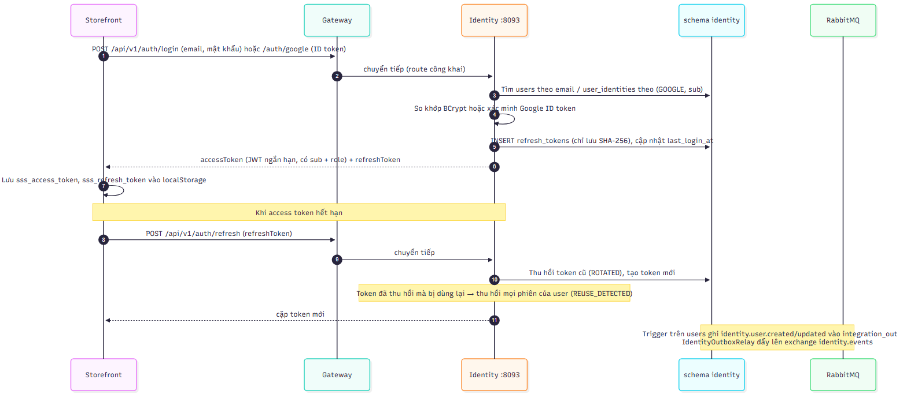

Mã nguồn sơ đồ: [`workflow/03-dang-nhap-jwt.mmd`](workflow/03-dang-nhap-jwt.mmd) · Bản vector: [`03-dang-nhap-jwt.svg`](workflow/03-dang-nhap-jwt.svg)

- Tài khoản tạo bằng Google thì không đăng nhập được bằng mật khẩu (trả 422 "This account uses Google sign-in").
- Google login: Identity gọi `tokeninfo` của Google, yêu cầu `email_verified = true` và `aud` đúng client ID.
- **Khác bản cũ:** chưa có bước gộp giỏ khách vãng lai vào giỏ tài khoản sau khi đăng nhập.

---

## 4. Xem sản phẩm và giỏ hàng

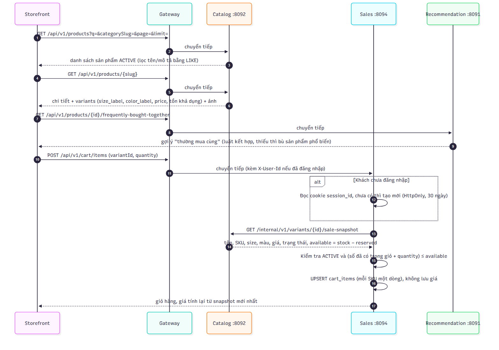

Mã nguồn sơ đồ: [`workflow/04-xem-san-pham-gio-hang.mmd`](workflow/04-xem-san-pham-gio-hang.mmd) · Bản vector: [`04-xem-san-pham-gio-hang.svg`](workflow/04-xem-san-pham-gio-hang.svg)

- Mọi lần đọc giỏ, Sales gọi `GET /internal/v1/variants/{id}/sale-snapshot` của Catalog cho từng dòng. Vì vậy giá trong giỏ luôn là giá mới nhất.
- Trang chi tiết sản phẩm gọi thêm `frequently-bought-together` sang Recommendation (mục 10).

---

## 5. Đặt hàng và thanh toán (COD / VietQR)

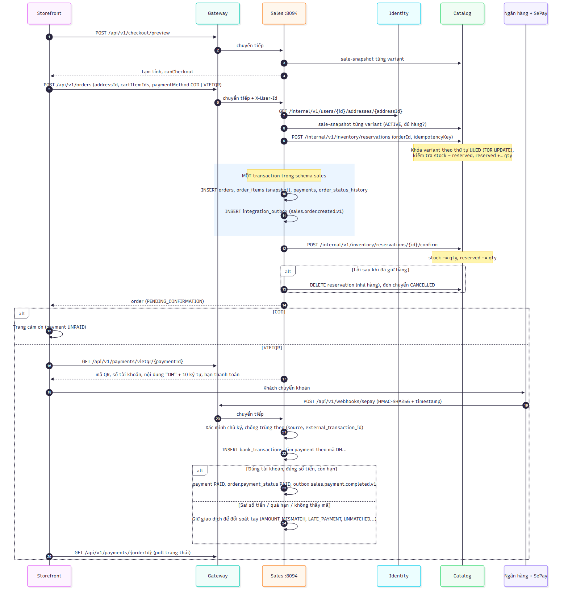

Mã nguồn sơ đồ: [`workflow/05-dat-hang-thanh-toan.mmd`](workflow/05-dat-hang-thanh-toan.mmd) · Bản vector: [`05-dat-hang-thanh-toan.svg`](workflow/05-dat-hang-thanh-toan.svg)

**Điểm chính khi bảo vệ:**
- **Không bán vượt tồn kho:** Catalog khóa các variant theo thứ tự UUID (`SELECT ... FOR UPDATE`), kiểm tra `stock − reserved ≥ số lượng` rồi mới tăng `reserved`. Khóa theo thứ tự cố định để hai đơn đồng thời không bị deadlock.
- **Idempotency khi giữ hàng:** Sales gửi `idempotencyKey`. Gửi lại cùng key thì Catalog trả đúng phiếu cũ, không giữ thêm. Code kiểm tra key hai lần (trước và sau khi khóa) để chặn cả trường hợp hai request trùng chạy song song.
- **Giao dịch phân tán xử lý bằng bù trừ:** đơn hàng (schema `sales`) và tồn kho (schema `catalog`) không nằm chung một transaction. Sales làm theo thứ tự giữ hàng → ghi đơn → xác nhận. Nếu bước sau lỗi thì nhả hàng (`DELETE reservation`) hoặc chuyển đơn sang `CANCELLED` với lý do `CATALOG_RESERVATION_CONFIRM_FAILED`.
- **Tồn kho bị trừ ngay khi đặt đơn** (reservation được confirm luôn), không đợi admin xác nhận như bản cũ.
- **SePay webhook:** chữ ký HMAC-SHA256 trên `timestamp + "." + raw body`, có giới hạn lệch thời gian, so sánh thời gian hằng. Trùng `(source, external_transaction_id)` thì trả kết quả cũ. Chỉ khi đúng tài khoản nhận, đúng số tiền, đúng mã `DH...` và còn hạn thì đơn mới thành `PAID`.

---

## 6. Vòng đời đơn hàng

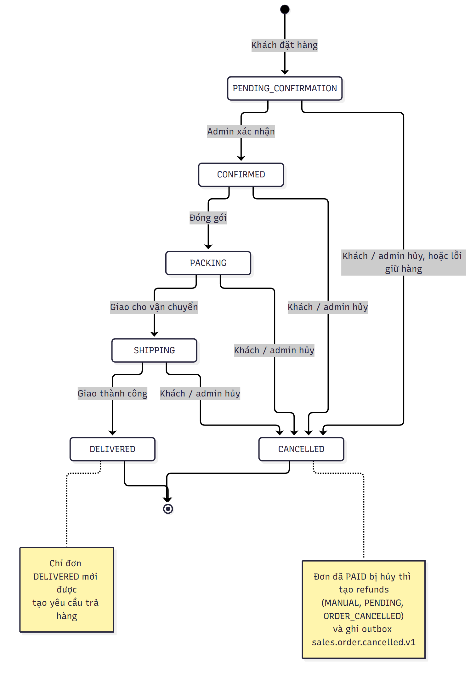

Mã nguồn sơ đồ: [`workflow/06-vong-doi-don-hang.mmd`](workflow/06-vong-doi-don-hang.mmd) · Bản vector: [`06-vong-doi-don-hang.svg`](workflow/06-vong-doi-don-hang.svg)

- Admin đổi trạng thái bằng `PATCH /api/v1/admin/orders/{id}/status`. Mỗi lần đổi ghi `order_status_history`.
- Khách hủy bằng `POST /api/v1/orders/{id}/cancel`, admin bằng `POST /api/v1/admin/orders/{id}/cancel`. Mọi trạng thái trừ `DELIVERED` và `CANCELLED` đều hủy được.
- Đơn đã `PAID` bị hủy thì tạo lệnh hoàn tiền `MANUAL` ở trạng thái `PENDING`; khách khai báo tài khoản nhận qua `PUT /api/v1/orders/{id}/refund-destination`.

**Hạn chế hiện tại của code** (nên biết để trả lời hội đồng):
- Endpoint đổi trạng thái của admin chưa kiểm tra thứ tự chuyển trạng thái hợp lệ.
- Hủy đơn chưa gọi Catalog để hoàn lại tồn kho đã trừ.
- Chưa thấy code điền `delivered_at` và `return_eligible_until` khi đơn chuyển `DELIVERED`, nên hạn trả hàng 7 ngày chưa được áp dụng.

---

## 7. Đồng bộ dữ liệu qua sự kiện (outbox → RabbitMQ)

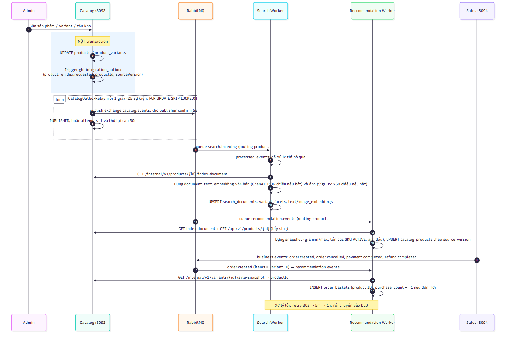

Mã nguồn sơ đồ: [`workflow/07-dong-bo-su-kien.mmd`](workflow/07-dong-bo-su-kien.mmd) · Bản vector: [`07-dong-bo-su-kien.svg`](workflow/07-dong-bo-su-kien.svg)

- **Transactional outbox:** sự kiện được ghi vào `integration_outbox` trong **cùng transaction** với thay đổi dữ liệu (ở Catalog bằng trigger DB). Relay đọc bảng này và publish sau. RabbitMQ lỗi thì sự kiện vẫn nằm trong bảng, không bị mất.
- **Idempotent consumer:** mỗi worker ghi `processed_events (consumer_name, event_id)`. Nhận lại cùng sự kiện thì bỏ qua.
- **Sự kiện mang ít dữ liệu:** Catalog chỉ gửi `productId` + `sourceVersion`. Search Worker tự gọi API `index-document` để lấy bản mới nhất. Nhờ vậy thứ tự sự kiện không quan trọng.
- **Retry và DLQ:** lỗi thì chuyển sang queue `.retry.30s` → `.retry.5m` → `.retry.1h`, cuối cùng vào `.dlq` để người kiểm tra.

---

## 8. Tìm kiếm văn bản

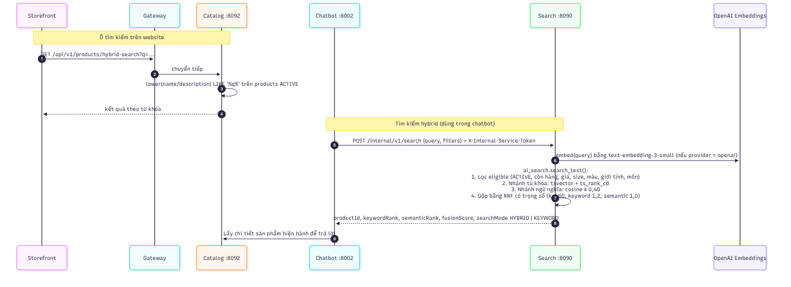

Mã nguồn sơ đồ: [`workflow/08-tim-kiem-van-ban.mmd`](workflow/08-tim-kiem-van-ban.mmd) · Bản vector: [`08-tim-kiem-van-ban.svg`](workflow/08-tim-kiem-van-ban.svg)

- **Ô tìm kiếm trên storefront** gọi `/api/v1/products/hybrid-search`. Tên endpoint giữ nguyên để tương thích, nhưng hiện Catalog chỉ lọc `LIKE` trên tên và mô tả.
- **Tìm kiếm hybrid thật** (từ khóa + ngữ nghĩa + RRF) nằm ở `search-service`, hiện được **chatbot** gọi. Không có OpenAI key (`TEXT_EMBEDDING_PROVIDER=disabled`) thì chỉ chạy nhánh từ khóa và trả `searchMode = KEYWORD`.

---

## 9. Tìm kiếm bằng hình ảnh

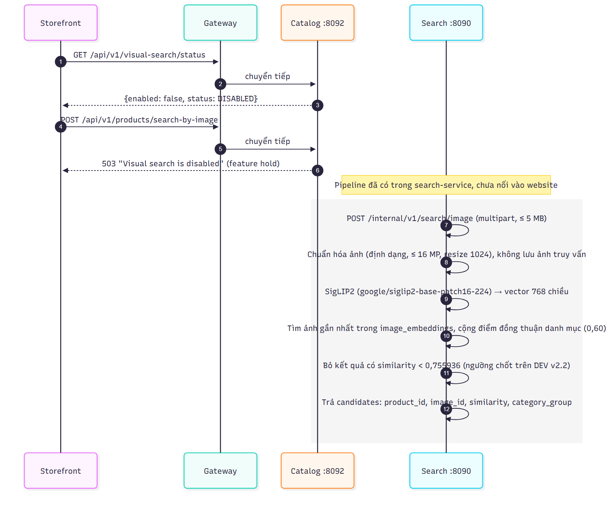

Mã nguồn sơ đồ: [`workflow/09-tim-kiem-hinh-anh.mmd`](workflow/09-tim-kiem-hinh-anh.mmd) · Bản vector: [`09-tim-kiem-hinh-anh.svg`](workflow/09-tim-kiem-hinh-anh.svg)

Đang **feature hold**: endpoint public của Catalog trả 503. Pipeline SigLIP2 trong `search-service` đã có, kèm bộ dữ liệu đánh giá DEV/TEST trong `datasets/image-search/`. Ngưỡng `0,755936` và trọng số đồng thuận danh mục `0,60` đã chốt trên DEV v2.2; muốn đổi phải chạy lại DEV và một TEST độc lập.

---

## 10. Chatbot

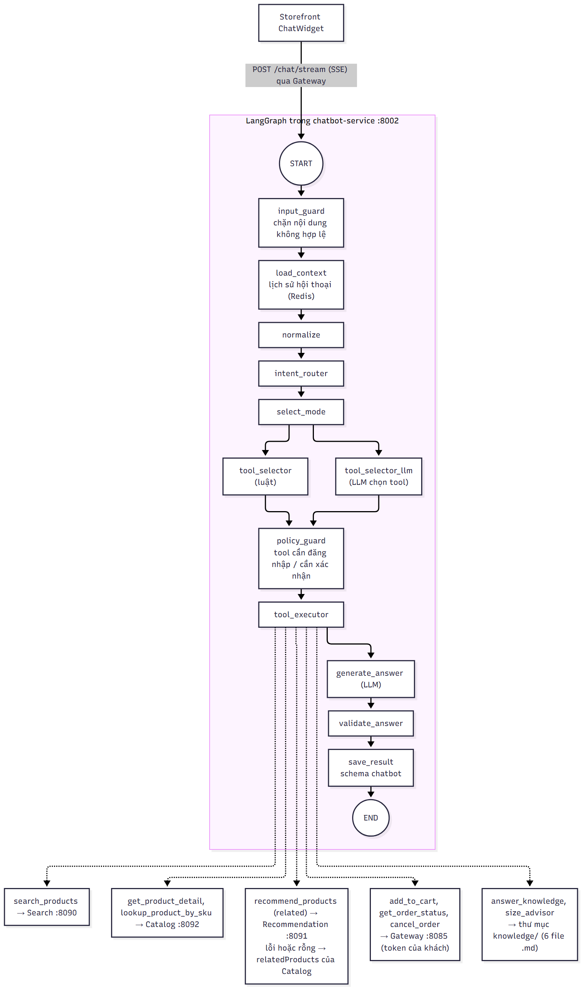

Mã nguồn sơ đồ: [`workflow/10-chatbot.mmd`](workflow/10-chatbot.mmd) · Bản vector: [`10-chatbot.svg`](workflow/10-chatbot.svg)

- Storefront gọi `POST /chat/stream` **qua Gateway** (`NEXT_PUBLIC_CHATBOT_API_BASE_URL`, mặc định `:8085`).
- LLM mặc định `MODEL_PROVIDER=anthropic`, có thể chuyển sang OpenAI.
- Tool thao tác giỏ/đơn gọi lại Gateway bằng token của chính khách, nên vẫn qua đủ kiểm tra quyền như khi khách tự thao tác. Tool hủy đơn cần khách xác nhận (`policy_guard`).
- Tool `recommend_products` chế độ "related" gọi thẳng recommendation-service (`GET :8091/api/v1/recommendations/products/{id}`), mỗi sản phẩm kèm lý do theo tầng ("Thường được mua cùng", "Hợp với sản phẩm bạn đang xem", "Đang được nhiều người mua"). Nếu service lỗi hoặc trả rỗng thì quay về `relatedProducts` của Catalog. Chế độ "need_based" dùng Search.

---

## 11. Gợi ý sản phẩm (recommendation)

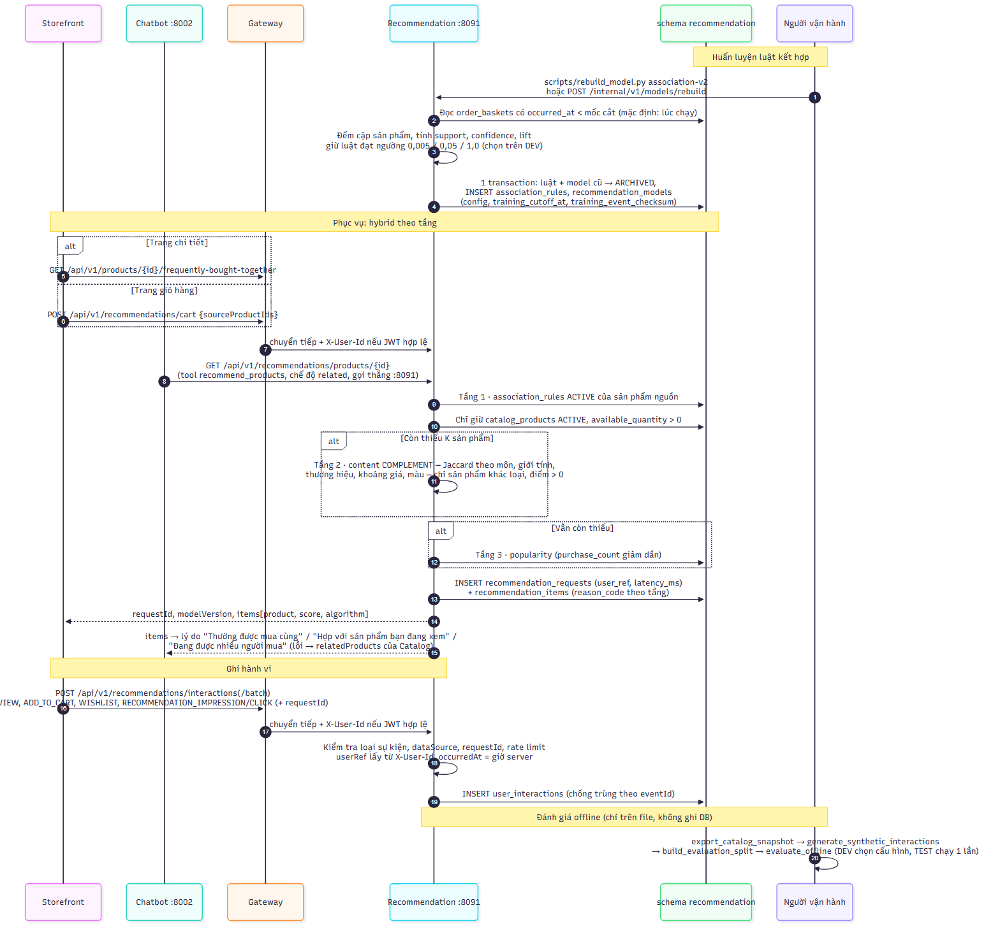

Mã nguồn sơ đồ: [`workflow/11-recommendation.mmd`](workflow/11-recommendation.mmd) · Bản vector: [`11-recommendation.svg`](workflow/11-recommendation.svg)

- Các API public qua Gateway: `GET /api/v1/recommendations/products/{id}`, `GET /api/v1/products/{id}/frequently-bought-together` (storefront đang dùng), `POST /api/v1/recommendations/cart`, `POST /api/v1/recommendations/interactions` (storefront gửi VIEW, ADD_TO_CART, WISHLIST, RECOMMENDATION_CLICK; `userRef` lấy từ JWT qua Gateway, không tin client) và `POST /api/v1/recommendations/interactions/batch` (tối đa 10 sự kiện mỗi request; storefront gửi cả 4 impression của khối gợi ý trong một lô). Rate limit: 60 sự kiện/phút/người, 300/phút/IP, đếm theo sự kiện.
- API nội bộ: `POST /internal/v1/events`, `POST /internal/v1/models/rebuild`, `POST /internal/v1/evaluations`.
- **Hybrid theo tầng** (`RecommendationService`): luật kết hợp → content `COMPLEMENT` (Jaccard theo môn, giới tính, thương hiệu, khoảng giá, màu; chỉ sản phẩm khác loại, điểm > 0) → popularity. Mỗi sản phẩm mang `algorithm`/`reason_code` của tầng sinh ra nó. Bật/tắt tầng content bằng `RECOMMENDATION_CONTENT_MODE` (`OFF`, `SIMILAR`, `COMPLEMENT`).
- Storefront hiển thị hai khối: "Thường mua cùng nhau" ở trang chi tiết và "Có thể bạn cũng cần" ở trang giỏ hàng (`POST /api/v1/recommendations/cart`, `source = CART_RECOMMENDATION`). Cả hai ghi impression/click kèm `requestId`.
- Rebuild luật chỉ dùng giỏ trước mốc cắt, ghi `config`, `training_cutoff_at`, `training_event_checksum` vào `recommendation_models`; mỗi lần gợi ý ghi `user_ref`, `latency_ms`.
- Service chỉ phục vụ khi `RECOMMENDATION_ENABLED=true`; tắt cờ thì mọi API trả 503. Đây là cách rollback. Storefront bắt mọi lỗi và chỉ ẩn khối gợi ý, trang sản phẩm vẫn hiển thị bình thường.
- Đánh giá offline và kết quả: [`docs/recommendation-design.md`](../recommendation-design.md), [`docs/recommendation-results.md`](../recommendation-results.md). Các việc còn lại nằm trong [Mission.md](Mission.md).

---

## 12. Trả hàng và hoàn tiền

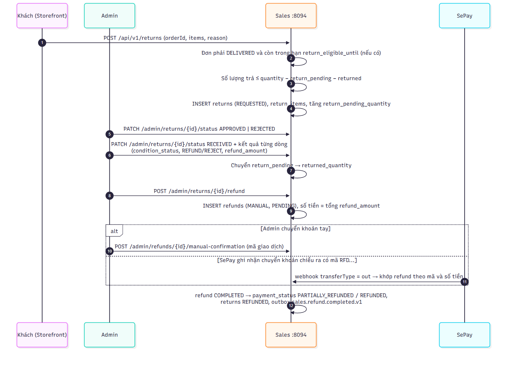

Mã nguồn sơ đồ: [`workflow/12-tra-hang-hoan-tien.mmd`](workflow/12-tra-hang-hoan-tien.mmd) · Bản vector: [`12-tra-hang-hoan-tien.svg`](workflow/12-tra-hang-hoan-tien.svg)

- Trạng thái trả hàng chỉ đi theo các bước cho phép: `REQUESTED → APPROVED | REJECTED | CANCELLED`, `APPROVED → RECEIVED`, `RECEIVED → REFUNDED`. Bước khác bị từ chối.
- Lệnh hoàn tiền: `PENDING → PROCESSING | COMPLETED | FAILED | CANCELLED`, `PROCESSING → COMPLETED | FAILED`, `FAILED → PROCESSING | COMPLETED | CANCELLED`.
- Khi hoàn xong, Sales tính lại `payment_status` của đơn: tổng đã hoàn ≥ tổng đã trả thì `REFUNDED`, ngược lại `PARTIALLY_REFUNDED`.
- Hàng trả về hiện chưa được nhập lại kho tự động (cột `restocked` có nhưng chưa dùng).

Xem thêm: [Database Structure.md](Database%20Structure.md) · [Summary.md](Summary.md) · [Mission.md](Mission.md)
